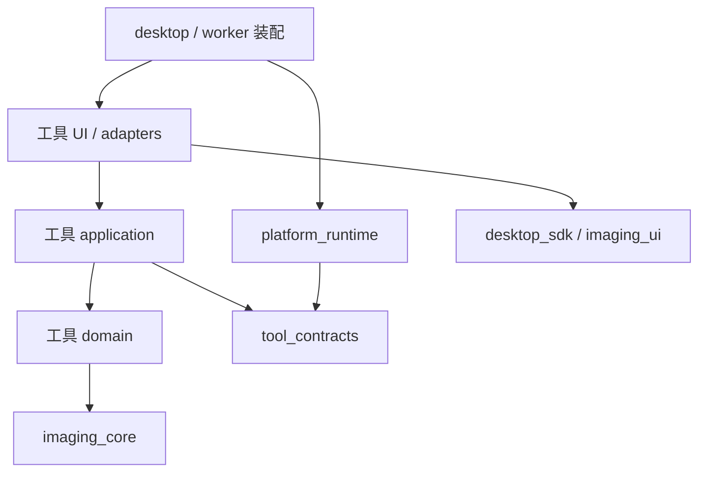

# 架构与依赖约束

## 决策与状态

遵循 V3.0 方案，采用本地模块化单体、单仓库分包和 worker 进程。一个产品整体发布，内部通过接口隔离变化。已实现 WB 计算/严格 worker 协议、平台工作区和 Qt 宿主；当前正常入口为 Qt WebEngine 承载的 WebWorkbenchWindow，旧原生窗口仅显式兼容入口。schema10 清单提供稳定 Fig/蛋白行/槽位身份；E1–E6 已连接阶段调度、固定 N 原值裁剪、完整 Fig 提交后原像素定量、身份填表及新目录导出恢复，阶段证据演进至 schema14。显示变换与定量输入分离，独立灰度/OCR和历史读取保留。当前工程验证、主线集成与外部验收边界见 [验收索引](wb-execution-acceptance.md)及 T-060；[执行基线](execution-baseline.md)保留 E0 当时事实。

## 允许的依赖

| 模块 | 允许的项目依赖 | 禁止 |
|---|---|---|
| tool_contracts | 无；标准库/Pydantic | Qt、NumPy、SQLite、平台与工具实现 |
| platform_runtime | tool_contracts.api | Qt、具体工具、实验字段 |
| desktop_sdk | tool_contracts.api | 平台内部、具体工具 |
| imaging_core | 必要的通用契约类型 | Qt、平台实现、实验语义 |
| imaging_ui | imaging_core.api、desktop_sdk.api、契约 | 工具领域类 |
| tool.domain | 本工具纯数据、数学库、纯 imaging_core.api | Qt、I/O、application/adapters/UI、其他工具 |
| tool.application | 本工具领域、契约、所需图像 API | UI、具体适配器、平台内部、其他工具 |
| tool.ui / adapters | 本工具用例；适用的 SDK/图像 API | 跨工具内部调用 |
| apps 装配 | 显式注册的具体实现 | 实验公式、不断增长的工具特判 |

外部只 import `包名.api`。内部类型不成为跨包事实 API；不返回整个窗口、容器、数据库连接或任意服务定位器。动态 import 仅限固定应用注册表，不能从用户工作区读取模块名执行。包导入不打开窗口、扫磁盘、联网、加载模型或启动计算。

## 如何执行约束

当前 AST 检查拒绝已登记包的直接非法依赖、跨包内部路径、部分动态导入，以及新建但未登记的 src 包。正反例测试故意引入 Qt、平台→工具、跨内部 API 和相对导入违规，确认门禁会失败。

**限制**：AST 不是完整安全或运行时证明；别名、反射、导入包装器及传递依赖仍可能逃逸。WB 包已启用 import-linter 层级、forbidden 和 TIFF 输入/积分模块 independence 合约，并构建 wheel 后在隔离环境验证公开 API。新包落地同步扩展这些合约与隔离安装测试，不能用单模块空泛通过替代独立性检查。

apps 装配表与注册代码单独审查；第一版没有自动跨工具编排。第二工具必须仅修改自己的模块、注册表和声明依赖，若频繁改 runtime 的实验分支，应先修边界。

## 进程与数据

GUI 主线程仅更新控件。真实运算、较大文件读取和导出在 worker 或适当异步端口，禁止 GUI 线程 `waitForFinished` 等阻塞等待。环境探针允许同步等待以检查安装，但不得复制成产品架构。

候选 IPC 为有界 UTF-8 NDJSON；stdout 只传协议，stderr 日志；大图/数组通过资产引用。必须有版本握手、分帧、run/attempt/request ID、序号与过期消息拒绝。

终态只由宿主提交。结果先 staging，关闭文件并校验摘要、大小、路径后发布唯一目录，再提交 SQLite；文件系统和数据库不是同一事务，必须做断点故障注入与重启清理。取消先记录状态，确认终止后才宣告 cancelled；未知状态为 interrupted。

原图、输入快照、已完成结果不可覆盖；preview、draft、run result 分离。新草稿不会被旧任务完成消息覆盖。工作区格式、schema、算法、模型、协议和应用各自版本化。兼容范围通过真实历史样例证明。

## 演进与失效条件

只有两个真实消费者的稳定共性才提升为公共能力。大模型依赖冲突时另立 worker 环境，不把 GPU 依赖拖入所有工具。若 P0 Qt 原生库、目标机打包或交互达不到要求，新增 ADR 比较备选栈；不静默扩大框架、不直接推翻原始方案。
