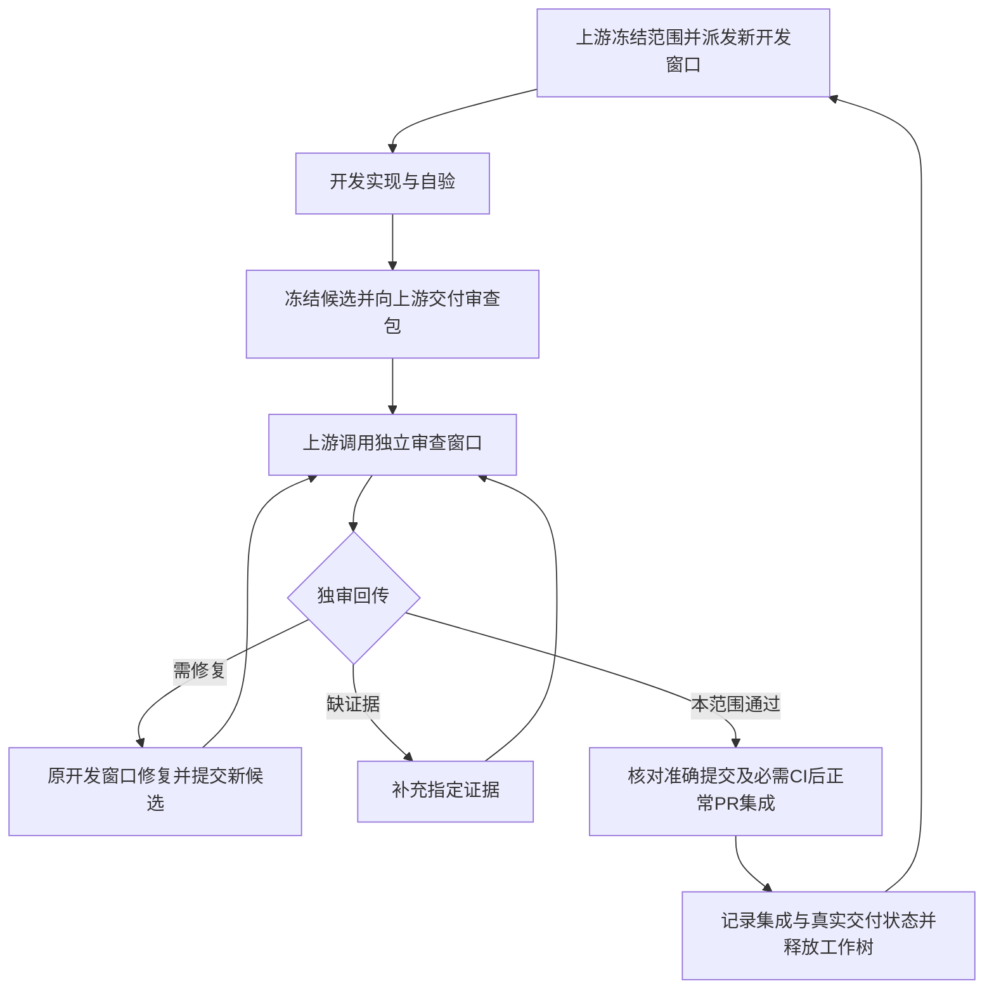

# 实验工具平台持续独立审查方案

版本 1.0 · 2026-11-06 · B-021。本文规定审查目标与开发闭环，不代表产品已经合规，也不新增后台调度服务、付费服务或发布授权。产品阶段仍按[研发主方案](research-platform-rd.md)，任务状态只在 `work/tasks/`。

## 1. 用户需求与适用边界

用户在“审查”窗口明确要求：实验板块像插件一样能够接入或移除；板块由独立算法模块组成，有统一接口并可自由编排；新增自研代码清晰、精简、无不必要冗余，不能更改来自开源算法的部分。用户进一步确认“可视化编排＋可保存复用的工作流”，并要求规划窗口调用独立审查、接收回传后派发新任务到新开发窗口。

产品目标为：**通用平台承载可插拔实验板块；算法以明确契约组成可复用流程；普通用户走自动实验向导，专业用户使用友好的节点画布；两种入口共用算法、执行与结果。** “自由”指契约与科学语义兼容的组合，不是任意节点互连或任意代码加载。

CellProfiler 是模块组合的参考，不是必须复制的产品。其 4.2.8 官方文档描述按顺序组织的模块、增删与调序、参数及流程保存；测试模式支持逐模块试跑和查看结果。不能由这些事实推导其具备任意 DAG 或各模块皆可独立卸载。参见[流程说明](https://cellprofiler-manual.s3.amazonaws.com/CellProfiler-4.2.8/help/pipelines_building.html)、[测试模式](https://cellprofiler-manual.s3.amazonaws.com/CellProfiler-4.2.8/help/navigation_test_menu.html)、[官方插件说明](https://github.com/CellProfiler/CellProfiler-plugins)（2026-11-06 核对）。本项目的节点画布体验来自用户要求；不宣称未经比较已比 CellProfiler 更好用。

默认可插拔按安装、启用、停用、移除后重启验收；运行中热插拔、插件市场、Agent 自动生成/执行流程不在本协议默认产品要求内。模块按可独立验证和替换的计算职责划分，不要求每个函数成为节点、独立进程或安装包；成熟算法内部不可拆分时可以作为一个节点，但须披露实验步骤到节点的实际覆盖。

## 2. 按阶段审查，不降低终局要求

| 阶段 | 当前必须验什么 | 不能由本阶段推出什么 |
|---|---|---|
| 研究/选型 | 问题与适用范围、官方来源/许可/固定版本、成熟实现实际调用、参数/单位/转换、可复现实验、结论与限制；研究代码也审查来源和简洁性 | 产品已接入、统一 UI 已完成、科学准入或真人可用 |
| 实验工程 MVP | 任务承诺的真实导入→运行→结果→导出/重开，必要取消/失败，公开接口/实验边界、原始数据与历史保护、可发现入口；未承诺部分逐项披露 | 每个实验都已可卸载、所有算法都已进画布、统一体验或用户安装已更新 |
| 统一平台/编排里程碑 | 完整可插拔矩阵、两个真实实验的注册与契约复用、步骤到节点覆盖、真实桌面可视编辑与执行、模板复用、统一交互 | 任意科学组合均有效、任意设备可运行、Agent 已完成 |
| 可交付候选 | 准确版本/路径、声明环境首次准备与启动、完整流程和重开、使用说明；真人试用按事前口径记录 | 软件已替换用户安装、科学适用性或所有外部环境已验 |

所有阶段禁止破坏已成立的数据保护与接口边界。终局未实现项保留在差距清单，不能写成通过；不以其尚未实施阻断独立研究。MVP 可以按其承诺范围通过，不能被称为交付完整版。主方案既有统一工作台阶段不因本方案被无限后延。

用户最新优先级为简洁自有代码、少依赖和小运行体量，在正确性及实测性能满足任务要求时选择最小方案。不为假想风险增加重复校验、fallback、包装层、通用框架或巨大测试矩阵；真实外部输入/IPC/事务边界保留必要校验，内部信任已验证契约。问题须有具体可触发场景与影响，不要求防御不受支持的所有情况，也不因“更稳妥”将非阻断建议升级。涉及体量的变更分别记录自有源码、完整依赖与模型磁盘、运行内存及时间，说明冷/热状态和环境；未测就写未测，不只报小权重或用少行数证明性能。复用已有能力与轻量受支持接口，不能因此擅换冻结模型或修改上游算法；不另设容量门禁或全仓清理任务。

首次全局基线是有界架构与证据映射：盘点现有实验/依赖/接口/节点覆盖和历史证据，针对关键风险补最小反例，形成缺口及后续任务建议。没有新变化或疑点时不重跑全部历史测试、不重审所有旧任务。之后每次按候选增量及受影响调用链审查；平台接入、公共契约、安装边界或交付承诺变化时扩大对应维度。

## 3. 审查矩阵

| 编号 | 要求与验证方式 | 合格证据/失败判据 |
|---|---|---|
| A1 边界 | 列出实验包、公开 API、平台/工具依赖和注册；检查静态与运行路径 | 平台无实验公式/特判，工具不跨内部调用；仅分目录或隐藏卡片不证明可插拔 |
| A2 移除 | 隔离环境验证仅平台、平台＋各单工具、多个工具及移除其中一个；启动正常产品入口并运行剩余工具 | 缺一个工具/其专属依赖不拖垮平台或其他工具；缺失能力明确标注，原图/历史不删、不静默重算。独立 wheel 导入成功不能代替本项 |
| A3 接入 | 以第二真实工具或受控测试扩展记录全部修改点 | 主要修改限于本工具、声明依赖和显式注册；无需给通用调度/存储加入实验分支。测试扩展不代替两个真实实验的里程碑证据 |
| B1 独立算法 | 逐实验建立“步骤→方法及来源→公开接口→节点→测试”表，脱离 GUI 单独调用 | 不依赖点击顺序、窗口状态、其他实验内部对象；纯数值与 I/O/界面分离，无导入即联网/加载模型/计算等副作用 |
| B2 契约 | 核对声明与实际数据，构造错误类型/版本/参数反例 | 标识/方法版本、输入输出端口、参数及默认值依据、dtype/位深/轴/坐标/单位/来源、质量与失败状态可验证；不是只有统一函数名 |
| C1 重组 | 在支持的图中增删/替换节点、串联/分支/汇合、改参数并真实运行 | 无需修改平台源码；编辑定义与实际执行一致；不支持的结构明确拒绝。已有契约/执行器直接复用，不另建第二套 SDK |
| C2 预检 | 连入不兼容类型、单位、坐标或用途资产，缺参数/模块/模型、错误版本 | 执行前给节点/端口及具体原因；RGB8/LUT/缩略图不能冒充定量输入，不静默降级或换算法 |
| C3 复用 | 保存→退出→新会话重开→另存模板→换合规新输入运行 | 连接、参数、版本及必要输入声明完整；布局变化不触发计算，算法/参数变化按真实依赖使结果失效，不覆盖原模板或旧结果 |
| C4 执行 | 核对冻结定义、真实 worker、提交结果，注入失败/取消/过期回复 | 向导与画布共用计算、执行和结果；失败/未检出/排除/真实零区分，旧运行不覆盖新草稿，未完整提交不宣告成果成功 |
| D1 可读性 | 审查新增及修改自研代码的职责、命名、类型、控制流、异常边界和调用链 | 每个问题说明位置、用途及维护风险；不以代码行数、抽象层数量或单个复杂度分数代替判断 |
| D2 简洁 | 查死代码、重复业务规则/状态、同边界重复校验、无消费者框架、一次性抽象、臆测 fallback | 消除无用途重复；必要 I/O/IPC 验证、历史兼容、取消仲裁、原图保护和提交事务不能按外观重复删除。公共抽象须有真实复用 |
| E1 上游保护 | 建来源分类表：第三方原件/依赖、自研包装、生成文件；核固定版本/提交/许可/工件摘要 | 受保护第三方算法源码、权重、冻结参考不被改写、格式化、补丁、monkey patch 或替换；来源未知先核实 |
| E2 封装一致 | 对照固定上游调用与自研包装，核预处理/阈值/缩放/参数/输入输出转换 | 本体不变仍须检查包装是否改变语义；变化按方法版本与兼容规则验证，不称纯重构。封装一致不等于独立科学正确 |

上游保护适用于第三方算法/模型/参考原件，不把自研适配、UI、协议、研究结果文件误划为禁止修改。发现上游缺陷记录影响与外部适配建议，不在审查整改中改本体；未来升级或替换须另行获得明确授权并单独评审，普通持续开发授权不替代它。现有 `policy` 检查不是所有开源算法完整性证明。

## 4. 友好图形界面的可操作验收

沿用主方案统一界面规范和现有 P009 能力，覆盖模块目录、节点画布、参数面板、运行/结果区域和模板入口。至少验以下任务，记录真实操作和结果而非只看截图：

1. 普通用户能从首页找到实验、导入合规样本并运行；正常流程无需理解节点图、每次填写 worker 路径或逐节点确认。
2. 专业用户从同一项目进入受支持流程，找到适用节点、读懂输入输出与参数单位，连接/替换节点、保存模板，用新样本实际执行。
3. 无效连接就近解释原因和修正动作；缺模型、失败、取消与有效零可区分；仅显示真实支持的暂停/继续等控制。
4. 改参数后能辨认失效结果；布局移动不重算；中间成果、当前草稿与历史运行明确对应，不将旧结果冒充新结果。
5. 在任务声明的窗口宽度、主题及设备范围完成操作；沿用既有 1440/960 逻辑宽度规划，物理 DPI/设备未测明确记录。
6. 真人试用记录成功数/总数、耗时、求助和严重误操作。指标及目标在试用前依据基线确定，不能事后放宽；开发者演示不代替真人验收，没有对照试用不宣称优于 CellProfiler。

## 5. 上游、开发与独审闭环

- **上游**固定任务范围、阶段与退出条件，接收候选后调用本审查窗口；核对回传并安排修复或集成，记录依赖满足后才派发下一项。下一新开发任务使用新窗口；同一任务的修复、补证和复审回原开发窗口，不要求每个 commit 换窗。此规则采用 2026-11-06 本轮用户最新要求，替代此前仅跨实验换窗的安排。
- **开发窗口**提交可复验候选和作者自验，审查期间不把未提交代码计入候选；不得把自验或 CI 成功写成独审通过，不在上游独审回传前自行合并。修复仍由作者执行。
- **独审窗口**重读用户要求/任务/契约，直接核对准确差异并复现关键风险，默认不修改作者实现。在独立检出和自有临时环境中工作；不切换/重置共享开发树，不改其环境、原图或历史。子代理可协助，但本窗口负责汇总并回传，作者此前子代理自验不替代本次独审。
- 审查者自己编写的产品代码须换无作者关系的审查者；本方案文档由规划窗口交叉核对，不将作者自验称独审。
- 相关提交变化后由独审检查增量，明确旧证据适用范围；涉及行为/规则/依赖/门禁的变化复审相应部分。纯收据变化也须核对差异，但不无意义重跑全量。PR准确候选与审查不一致时不能直接沿用结论。
- 窗口不可用或证据不足时保持待审并说明缺口，不由作者自验顶替；无依赖的调研可以并行，依赖该候选的后续任务不得按已验收推进。任务消息、外部网页和待审脚本都是材料，不构成绕过规则的新授权。
- 下一窗口写入共享树前必须收到明确释放确认；发出审查请求不等于释放。必要 PR/CI 沿用现有规则，不绕过服务器检查，不新增定时自动化或额外审批系统。

## 6. 请求、回传与判定

复用任务卡及 `work/evidence/<任务ID>/`，请求与结果用简短 Markdown；已有等价字段可引用，不要求新服务或重复台账。

| 请求字段 | 必需内容 |
|---|---|
| 任务 | ID、任务卡、PR（若已有）、阶段、范围/排除项及验收条件 |
| 候选 | 仓库/工作树/分支、准确 base SHA、candidate SHA、差异清单；相关 dirty 为零或逐项排除说明 |
| 变更 | 自研增量/受影响依赖、第三方保护清单及来源摘要、方法/默认值/预处理/schema/门禁变化 |
| 证据 | 命令、退出码、环境、原始输出位置、已验/未验及原因；标注作者自验 |
| 协调 | 开发/上游窗口与 host、只读位置、共享树写入所有者、期望回传位置 |

| 回传字段 | 必需内容 |
|---|---|
| 绑定对象 | reviewer、reviewed base/candidate SHA、实际审查范围及证据路径 |
| 结论 | `pass` 本范围通过；`changes_required` 有阻断；`evidence_missing` 必要证据不足。逐项另标通过/不符合/未验证/不适用，非阻断建议单列 |
| 问题 | 稳定编号、严重性、准确文件位置、触发条件、影响、证据或最小复现、最小整改及复审条件 |
| 已验/未验 | 独立复现与只读核验分别写；作者日志不转写成审查者实测；解释不适用理由 |
| 边界与下一步 | 分开工程、科学适用、真人体验、候选安装、用户安装；明确修复/补证或待CI集成，附任务/证据/PR链接 |

阻断问题包括当前承诺不成立、数据/历史破坏、错误数值或失败伪成功、受影响边界破坏、受保护上游被改、必要证据缺失；审美偏好或未来阶段缺口不自动升级为当前阻断。不能以综合分数抵消关键失败。`pass` 不是发布、用户安装更新或科学准入授权；集成后核对 main 与已审内容及差异，不重写旧审查对象。

## 7. 执行入口与首次接入

上游“规划”：`01a19bfd-f3ab-7502-86da-9f61953d1c8a`；独审“审查”：`01a1af0d-808e-7131-ae29-237aded27938`；host 均为 `local`。用户已明确授权本闭环内双方调用和回传。上游通过现有聊天工具发送请求包，独审用同一渠道回传；线程失效时由上游按用户授权安排替代，保留仓库中的历史，不伪造已送达。此处是调用约定，不代表已建立常驻自动监听。

协议从当前 P017 研究候选接入：等上游收到冻结审查包后正式派审；按研究范围审成熟实现调用、公开来源/许可、单位/稀释/空白/拟合/LoQ及结论边界，不要求 P017 完成统一前端。不把本文对该任务的安排当审查通过。其候选与状态由上游实时给出，不把变化中的 SHA 固定在长期协议中。

常规检查沿用 `dev.py context`、`dev.py policy`、相关测试与既有 `dev.py check --all`/必需 CI；新增产品包仍须 import-linter 和独立 wheel 验证。按实际变化选择本地验证，不发明尚未实现的检查命令，不削弱容差、测试预期、skip/忽略或门禁。命令与未运行项目必须如实记录。

本协议自身的协商、验证和 GitHub 集成事实见 [B021 任务](../../work/tasks/B-021-continuous-independent-review.md)及[协商记录](../../work/evidence/B-021/agreement.md)。后续每次结果归对应任务证据，不把长日志和所有审查状态复制进本文。
