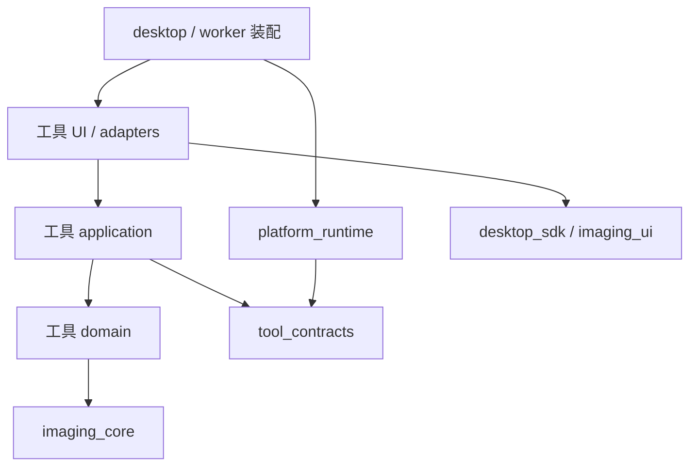

# 4.2工程规范增量（待接入）

只存放待接入文本，不能替代当前AGENTS、任务卡、模块地图和工程规范。P008结束后按同步评估逐项合并，保留实际产品树已更新的内容。

## 规划树来源：docs/architecture.md

```markdown
# 架构与依赖约束

## 决策与状态

采用本地模块化单体、单仓库分包和worker进程的渐进方向，一个产品整体发布，内部通过接口隔离变化。本目录是保留旧dirty产品的规划树，不代表最新实现。4.2[主方案](plans/research-platform-rd.md)合并真实操作复现与长期维护；[维护计划](maintenance-plan.md)提供职责分区和人工审查路线。本轮不写实际开发树，也不要求立即搬目录。

2026-11-02只读核对的实际bioimage-v0已有WB、工作区与通用执行基础，正在推进P008；具体状态仅以其任务为准。以下desktop_sdk、imaging_core、imaging_ui是有真实消费者后才考虑的分区，不表示已有包，不为满足目录图预建。

## 允许的依赖

| 模块 | 允许的项目依赖 | 禁止 |
|---|---|---|
| tool_contracts | 无；标准库/Pydantic | Qt、NumPy、SQLite、平台与工具实现 |
| platform_runtime | tool_contracts.api | Qt、具体工具、实验字段 |
| desktop_sdk | tool_contracts.api | 平台内部、具体工具 |
| imaging_core | 必要的通用契约类型 | Qt、平台实现、实验语义 |
| imaging_ui | imaging_core.api、desktop_sdk.api、契约 | 工具领域类 |
| tool.domain | 本工具纯数据、数学库、纯 imaging_core.api | Qt、I/O、application/adapters/UI、其他工具 |
| tool.application | 本工具领域、契约、所需图像 API | UI、具体适配器、平台内部、其他工具 |
| tool.ui / adapters | 本工具用例；适用的 SDK/图像 API | 跨工具内部调用 |
| apps 装配 | 显式注册的具体实现 | 实验公式、不断增长的工具特判 |



外部只 import `包名.api`。内部类型不成为跨包事实 API；不返回整个窗口、容器、数据库连接或任意服务定位器。动态 import 仅限固定应用注册表，不能从用户工作区读取模块名执行。包导入不打开窗口、扫磁盘、联网、加载模型或启动计算。

## 如何执行约束

当前 AST 检查拒绝已登记包的直接非法依赖、跨包内部路径、部分动态导入，以及新建但未登记的 src 包。正反例测试故意引入 Qt、平台→工具、跨内部 API 和相对导入违规，确认门禁会失败。

**限制**：AST 不是完整安全或运行时证明；别名、反射、导入包装器及传递依赖仍可能逃逸。WB 包已启用 import-linter 层级、forbidden 和 TIFF 输入/积分模块 independence 合约，并构建 wheel 后在隔离环境验证公开 API。新包落地同步扩展这些合约与隔离安装测试，不能用单模块空泛通过替代独立性检查。

apps 装配表与注册代码单独审查；历史第一版无自动跨工具编排的描述不作为当前停止条件。第二工具原则上只修改自己的模块、注册与必要契约；若频繁添加runtime实验分支，应先修边界。宿主负责进程/线程和存储端口接线，纯图规则与实验算法保持各自职责。

## 进程与数据

GUI 主线程仅更新控件。真实运算、较大文件读取和导出在 worker 或适当异步端口，禁止 GUI 线程 `waitForFinished` 等阻塞等待。环境探针允许同步等待以检查安装，但不得复制成产品架构。

候选 IPC 为有界 UTF-8 NDJSON；stdout 只传协议，stderr 日志；大图/数组通过资产引用。必须有版本握手、分帧、run/attempt/request ID、序号与过期消息拒绝。

终态只由宿主提交。结果先 staging，关闭文件并校验摘要、大小、路径后发布唯一目录，再提交 SQLite；文件系统和数据库不是同一事务，必须做断点故障注入与重启清理。取消先记录状态，确认终止后才宣告 cancelled；未知状态为 interrupted。

原图、输入快照、已完成结果不可覆盖；preview、draft、run result 分离。新草稿不会被旧任务完成消息覆盖。工作区格式、schema、算法、模型、协议和应用各自版本化。兼容范围通过真实历史样例证明。

## 演进与失效条件

只有两个真实消费者的稳定共性才提升为公共能力。大模型依赖冲突时另立 worker 环境，不把 GPU 依赖拖入所有工具。若 P0 Qt 原生库、目标机打包或交互达不到要求，新增 ADR 比较备选栈；不静默扩大框架、不直接推翻原始方案。

```

## 规划树来源：docs/coding-standards.md

```markdown
# 代码书写与质量规则

2026-11-02规划树4.2补充：职责分区、调用链导航、审查和维护节奏见[维护计划](maintenance-plan.md)。以下新增要求随相关功能渐进采用，不要求中断实际开发窗口全仓改写。

## 可读性与人工定位

- 模块README提供用户动作→公开入口→用例→算法/适配→输出→测试的短表，详细方法只链接一份权威记录。方法变化与真实操作的对应按[开发流程](plans/workflow-development.md)保存。
- 关键算法/状态文件用短docstring说明职责、输入输出含义、方法版本或关键不变量及参考位置。注释解释原因，不复述代码，不粘贴长聊天/日志/不断失效的行号。
- 函数和变量表达业务含义及必要单位；保持调用方向可读。公开接口变化考虑消费者，不用泛化字典、服务容器或动态查找隐藏依赖。
- 同一科学算法只保留一个权威实现，GUI/CLI/工作流复用；不同方法显式命名和版本化，不靠含义不清的开关切换。
- 入口验证后内部信任类型，只在确需处理的边界转换异常。来源/修订/进程/提交跨边界核验仍保留；不添加无实际故障依据的多重兜底。
- 不以行数强制拆分，不为一次转发新建包装层，不为假想消费者提炼公共框架。复杂文件先识别混合职责，相关任务中小步重构，保留行为参考。

## Python

- Python 3.12.14 是本次开发环境基线，不代表最终产品版本已冻结。生产成员用 src 布局、显式依赖和唯一公开 `api.py`。
- 公共参数、返回值和复杂内部状态有类型。Pyright strict 为唯一主要类型检查器；第三方 Any 在适配边界转换，不向领域层传播。
- Ruff 负责格式和明确静态规则；遵循工具，不另立相互矛盾的风格手册。不用全仓 `type: ignore` 或 per-file 全量屏蔽绕过错误。
- 文件按变化原因划分；命名表达实验/技术含义，禁止 `utils.py` 逐渐成为业务聚合。少量 Protocol 与组合优先于万能基类。
- 输入数据默认不原地修改；不可变 dataclass 表达稳定值，Pydantic 负责外部边界，不用字典包办领域类型。
- 捕获最窄异常并保持原因；稳定错误码给机器，中文提示给用户，诊断详情存日志。失败不返回“成功＋空列表”。

## 数值、图像与科学语义

- 原始像素与显示变换分离。预览缩放、伪彩和对比度不能改变定量数组。
- 自动几何校正是正式分析预处理，须保存方法版本和保精度派生资产，预览/ROI/测量共用该资产；这不允许把RGB8显示数组送入定量。旧显示角保持历史语义，改变结果的校正方法独立验证和迁移。
- 显式定义 dtype、单位、轴顺序、坐标系、ROI 边界、像素/物理尺度与舍入；整型运算提升精度，检查 NaN/Inf/溢出。
- WB 参考模式的信号是均值剖面线性基线以上正差的梯形积分，不再乘宽度。闭区间剖面端点与半开区间图像切片须转换测试。正式实现前冻结参考代码和样本。
- 未检测、无效、失败、排除和真实零值区分。分母无效不加 epsilon 掩盖，不输出 Inf；返回状态及原因。
- 公式、默认参数、预处理或阈值影响结果时更新 algorithm_version 并提供逐例差异。纯重构与语义变化分开提交。
- 随机算法保存种子；BLAS/GPU 结果以预先定义容差复验。技术重复与生物重复不混为一谈。

## GUI、并发与资源

- View 只管理控件；Presenter 管交互状态；用例编排与领域计算独立测试。
- QObject 生命周期、signal 订阅和关闭清理有明确所有者。发给界面的结果携带源 revision；过期结果不覆盖新编辑。
- worker 限并发和线程，先按内存估算准入；预算不是 OS 硬限制。当前 16 GB 主机初期按单计算任务运行，之后测量再调整。
- 子进程用参数数组和明确 cwd，不拼接 shell 命令；管理整个进程树的停止，限制帧/日志大小，双向管道及时排空。

## 存储与边界

- 拒绝目录穿越、越界输出与未批准的符号链接/重解析点行为。验证实际路径归属，保存前校验输入摘要。
- SQLite 只由宿主存储层写；不在网络共享上直接并发修改。使用一致性备份，不只复制活动数据库主文件。
- 迁移先备份，在副本完成并验证，再显式切换。旧格式只读路径保留到声明的弃用期。日志默认不含原图、凭据或科研隐私。

## 测试与规则变更

测试按单位→性质→契约→真实进程/存储集成→GUI→安装包分层。每层验证不同风险，截图不代替数值证据。关键预期来自解析计算、冻结标注或独立实现，不复制被测公式。

出现修复后新失败，先判断根因，不靠无限重试。修改预期、容差、skip、忽略、依赖锁和门禁必须列出理由与受影响行为。基础设施的负例测试证明门禁有检出能力；机械重复实现的测试不算独立正确性证据。

```

## 规划树来源：docs/module-map.md

```markdown
# 模块地图

2026-11-02 B015：规划主方案已为4.2；[维护计划](maintenance-plan.md)提供代码职责分区与人工审查入口，[开发流程](plans/workflow-development.md)提供动作→方法→入口→测试→节点的追溯。实际产品地图请读取bioimage-v0同名文件；本轮未同步，不重排其任务。

以下为旧树/历史描述，不是当前版本或任务状态。B014只读核对显示P002已集成，P008正在推进；不得从历史包号或旧章节引用推断最新能力。WB实际文件定位见[只读核对](../work/evidence/B-014/code-audit.md)。

2026-10-31历史说明：以下包版本描述本目录保留的旧产品树。恢复开发时从实际树handoff和任务读取当前入口，不能重新启动已完成的P001/P002。本文不表示所有规划能力或Agent已实现。

标记“规划”的模块当前不存在；只有真实消费者和就绪任务出现时创建。

| 位置 | 职责与入口 | 状态 / 验证 |
|---|---|---|
| `dev.py`, `tooling/` | 开发检查与来源核验，不含业务算法 | 已建；`dev.py check --all` |
| `p0_probe.py`, `tooling/p0/` | T-002 可丢弃技术探针：Qt、进程、合成图和 standalone；不作为产品 API | 本机验证中；`tooling/p0/README.md` |
| `.agents/skills/` | 固定提交的第三方工作技能 | 已建；`tooling/skills-lock.json` |
| `tests/test_boundaries.py` | 边界检查的正反例 | 已建；pytest |
| `apps/desktop/` | 异步存储/进程、RunSession、WB窗口装配；`python -m bioimage_app`与静态wb/wb_ocr worker | 已建0.13.0；精确保存后直接TIFF/PNG后台导出与OCR往返；ZIP恢复、历史证据/真实本机run、元信息/定量/归一化与CSV |
| `packages/tool_contracts/` | `tool_contracts.api` 的文件资产、修订、运行/退出与恢复契约 | 已建 v1；schema 漂移和隔离 wheel |
| `packages/platform_runtime/` | `platform_runtime.api.Workspace` 输入快照、草稿 CAS、结果事务、恢复与备份 | 已建0.2.0/格式v1；新空工作区初始外来修订导入，不导入run；普通CAS与真实文件/SQLite、独立wheel |
| `packages/desktop_sdk/` | ToolView、Qt 生命周期、宿主 UI 端口 | 规划；pytest-qt |
| `packages/imaging_core/` | 原始图像、坐标和纯技术运算 | 规划；位深/几何/性质 |
| `packages/imaging_ui/` | 真实复用需求出现后的画布适配 | 规划，不预建 |
| `tools/wb/` | `wb_tool.api` 数值/单图文档v1/v2/严格协议、Qt画布/曲线/工作表、本地OCR与表格 | 已建0.18.0；完整显示TIFF/PNG像素/来源/DPI核验，已知显示图拒绝定量；有界ZIP/schema6历史，旧项目v1–v5兼容 |
| `tools/if_intensity/` | 第二工具验证平台边界 | 规划，WB 最小闭环后 |
| `tools/if_count/`, `tools/ihc_area/` | 各自独立的实验语义 | 后续规划 |

成员采用 `pyproject.toml + src/<import_name>/ + tests/`。公开入口 `api.py` 无初始化副作用。创建新成员须同时更新 workspace members、本地图、`tooling/boundaries.py`、import-linter 合约及 CI 的已安装包测试。不能只添加目录就宣布边界完整。

工具内部：`domain/` 纯数值与身份；`application/` 用例与端口；`adapters/` 文件/执行/导出；`ui/` view、presenter、view_state。模块 README 只记自己的 API、语义、输入输出、失败行为和命令。

```

## 规划树来源：docs/ai-workflow.md

```markdown
# AI 长期开发执行规程

产品主方案为[研发方案](plans/research-platform-rd.md)，HTML同名；新增实验按[从真实操作到模块的开发流程](plans/workflow-development.md)推进，代码分区、人工审查和长期维护按[维护计划](maintenance-plan.md)，B-005仅作配套治理。本文件不复制任务状态，依赖与任务路径见`work/programs/scientific-agent-platform/registry.json`。2026-11-02本地4.2仅为规划修订，未同步开发窗口，不改当前任务。

## 启动和选任务

1. 读AGENTS、handoff索引、snapshot、risks、backlog，再读主计划、registry及当前任务。核对真实代码树、分支、HEAD和dirty；本目录旧产品不能覆盖较新T-082树。
2. 恢复未完成的in_progress/in_review任务。否则按已授权范围选择依赖满足的任务；首次接入为P-001。不能按旧任务编号或main名字猜最新代码。
3. 在任务卡记录owner、base/head、范围和输入输出；运行`uv run --locked --no-sync python dev.py context --task <ID> --scope <目录> --record`并读取输出。目标树支持的--base/--integration按其实际runbook使用，不复制旧回执。
4. 修改前读取模块README/API/适用规则。普通实现选择自主处理；科学端点、样本授权、容差与结果含义不能臆造。已确认的全自动/统一旋转需求不重复询问。

## 实施和验证

先做一个可观察、可回退的行为切片。并行产品修改每任务独立worktree；公共契约单一协调者，彼此以提交/固定契约交接，不共享可变工作区数据库。只读核查与独审可并行。模型/推理设置沿用用户配置，不擅自改付费档位。

先跑与变化相关的测试，再按公共接口、迁移、安装和反向依赖扩大检查。依赖固定版本；每次更新独立diff，不为完成任务任意升级。失败两次且没有新假设时整理诊断并换验证方法，不持续叠补丁。命令、退出码、环境、commit、独立预期与未运行项写证据。

独立审查者检查base..head，自行验证关键反例。作者报告只作为线索；另一个模型的同意不自动证明正确。审查后任何相关代码变化使旧结论失效；main仍经PR和必需检查。规则回执证明加载，不证明自然语言全部被理解。

## 状态与完成

计划任务使用planned、in_progress、in_review、blocked、done。状态唯一写任务卡；registry不存状态，snapshot只保存指针。ready由依赖/范围/资源计算。产品实现自验后进入in_review，约定集成完成及提交独审通过才done；未发布不能写已发布。历史任务保留其原状态词，不批量改写。

科学/客户材料不足只阻止对应方法晋级或商业结论；可继续独立工程。blocked写清具体范围、解除证据、负责人角色和可并行下一项；不虚构完成，也不反复等待同一问题。任务过大时拆子任务，父任务只有在整体验收满足后才完成。

## 收尾与恢复

更新任务、验证、必要ADR与风险，替换snapshot当前指针；先归档再清理历史，执行agent-handoff容量检查。启动下一任务前重查依赖和基线；规则/范围/base变化重载context。任务模板及计划检查入口见`work/programs/scientific-agent-platform/README.md`。

每里程碑由新会话仅凭仓库完成一次有限接手验证，并记录其范围。B-005的文档冷启动审阅只验证找路和理解，不等于产品小变更接手已通过。当前4.2 Markdown是本地规划源；运行`node work/evidence/B-015/build_documents.cjs`生成主方案、开发流程和维护计划的HTML。旧构建/组装脚本保留历史，不覆盖当前交付；B-005 Word保持快照。实际开发树沿用它自己的便携构建器，未来接入时迁移渲染输入而非整套覆盖。

## 给Codex的执行提示：避免过度防御与过度设计

以下可直接作为后续开发任务提示词使用。它约束实现方式，不取消科学正确性、数据保护、独审和必需检查。

> 你正在实现一条已经确定的实验分析流程。先读取当前任务、实际代码和公开契约，再完成能够运行、能够验证的最小完整流程。
>
> 1. 从真实操作清单推导模块，不凭想象堆算法或设计覆盖所有实验的框架。优先复用现有实现和执行器。
> 2. 在文件、用户输入、插件、进程或外部软件等边界验证数据。内部已经通过契约验证的类型和不变量可以信任，不层层重复判空、转换或兜底。
> 3. 只捕获能明确处理或需要跨边界报告的异常。不能吞掉错误、填零、返回空成功，或擅自换算法来让任务看起来完成。
> 4. 只为已知故障和已要求的行为添加防护。不要为假想场景新增配置、缓存、恢复引擎、兼容层或多重重试。确需新增时指出对应任务需求或失败证据。
> 5. 普通实现选择自主完成，不重复询问已授权事项。科学方法含义、未知阈值和数据用途不能猜；缺口只阻止依赖它的部分，继续其他已具备条件的工作。
> 6. 先完成端到端切片，再整理真实重复。不为单次使用提前建立通用抽象，也不要把固定操作自动化升级成必须接入Agent的问题。
> 7. 测试真实行为、独立参考和关键失败路径，不写只重复实现的测试。相关检查通过且没有新变化时，不无休止重跑；既有必需门禁仍须完成，独审绑定可运行候选和最终提交。
> 8. 保留原始数据、历史结果、位深、单位与坐标；保证取消、异步保存和结果提交正确。这些是明确需求，不能以“简化”为由删除。
> 9. 收尾说明做出了什么、用什么证据验证、哪里仍有限制。未运行就写未运行，不把防护代码数量当进度。
>
> 10. 新实验先记录实际操作与调整依据，再确认方法、实现和对照。明确采用原实现、方法重实现还是替代方法；不能凭相似按钮或结果宣称同算法。
>
> 11. 让审查者从用户动作找到公开入口、关键计算和测试。只更新受影响的短导航与方法记录，不为普通修改生成重复文档，不为加分区标题保留混乱的大文件，也不为追求短小把逻辑拆成碎片。

提交前自查：每个新抽象、校验、异常捕获和重试是否解决了实际问题？是否可以借用已有能力？删除没有需求或证据支撑的复杂度，同时保留上述明确不变量。

```
