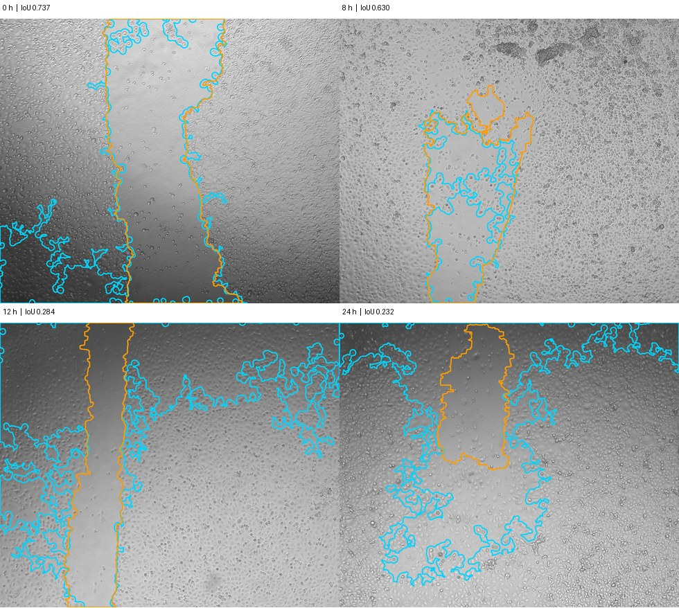

# 划痕闭合：一孔四帧的实测与排期判断

2026-11-09 · P030 · **保留研究候选，暂缓学生端全自动 MVP。** 固定参数的上游宏在 12 h 和 24 h 都把闭合方向算反。已有免费工具能生成面积与轮廓；本平台可能节省的步骤是配对、异常复核和按生物样本汇总，目前没有学生任务记录或耗时对照支持优先开发。此前 P013 已比较实验类型，v4 计划已识别 v2 数据；本次新增证据是一个可复查的视野和四组实测。

## 学生从原图到报告

1. 从采集记录导入处理组、生物样本/实验批次、板、孔、视野、实际小时和尺度。用同一孔同一视野的 0 h 配对后续图。检查方向、视野边界及焦面；漂移时应在有依据的配准后使用各时点共同有效区域并保存变换，无法确认时保留逐图面积、标记闭合率待核。
2. 每帧识别无细胞划痕，在原图显示轮廓，重点看暗角、碎屑、划痕分裂和晚期小间隙。保存原始图、算法版本、参数、原始预测和复核版本。面积用 mask 内像素数；只有 X/Y 像素尺寸已知时才乘两方向尺度，输出 µm²。面积占画幅百分比与相对初始面积闭合率使用不同分母。
3. 对可配对且初始面积大于零的视野，用各自的 0 h 面积算 `100 × (A0 − At) / A0`。同一画幅下面积增大会给出负值，应带符号复查。缺失帧列为缺失，已核实完全闭合才能报告零面积；宏的 `no_roi` 返回 NA。本研究只用本视野基线。上游最终表另有借用基线和来源字段，其跨视野规则未纳入本次验证。[作者闭合率实现](https://github.com/nykemariotto/scratch-assay-segmentation/blob/6cbd78da604291a4b1dbf1926b06e44279381af3/stage4/final_closure_table.py)
4. 导出逐帧原图标识、时间、面积及单位、轮廓、闭合率和质控状态，并保留含缺失原因的长表。按实验设计先汇集同孔各视野、同一样本的技术孔，再按处理组展示独立生物样本轨迹、样本数和离散程度。需事先约定视野等权或按初始面积加权、技术孔权重和缺失规则。当前只有一孔一视野，生物个体/独立批次重复数未知，不能算组效应或独立样本误差条。面积变化也不足以区分迁移和增殖。

## 一个有 0 h 的公开视野

Mariotto 等 v2 的原采集映射明确给出 HUVEC、批次 `LUIS RAW`、处理 `PEP+GB`、孔 E6、campo 2，四帧均为 `status=ok`、`resolucao=ok_hash`、相似度 1.0。以映射与最终归档共同筛选 train 中 0/8/12/24 h 各一帧、相同批次/孔/视野的首个合格排序组，选取在比较标签前完成。没有调参或训练。仅取四个 PNG（共 18,900,498 字节）及对应多边形；保留 val/test 像素及标签未见。数据及标注 CC BY 4.0。标注是在 Roboflow 绘制的训练多边形，本次不用作者的自动 WHST 数值作真值，也未证明盲法或多标注者一致性。[数据 v2](https://doi.org/10.5281/zenodo.21779854) · [采集身份表](https://github.com/nykemariotto/scratch-assay-segmentation/blob/6cbd78da604291a4b1dbf1926b06e44279381af3/data/mapping_huvec_final.csv) · [标注来源与划分](https://github.com/nykemariotto/scratch-assay-segmentation/blob/6cbd78da604291a4b1dbf1926b06e44279381af3/dataset/README.md)

在每帧的完整 2452 × 2056 像素画幅直接运行作者冻结的 WHST ImageJ 批处理宏。方差半径 20、阈值 100、对比度参数 0.001、最小粒子 100 px²，保留最大连通区域；这是该实现的参数，不能作为实验的最小可测面积。比较端将归一化顶点乘宽高、取最近整数、按多边形并集填充，计算空隙 IoU（交集/并集）。预测面积从宏 mask 计数，并与原生 CSV 核对。双方闭合率各用自己的 0 h 面积。无额外裁剪、缩放或配准；公开字段支持名义视野身份，缺少载物台轨迹、逐帧变换和物理像素标定。下表验证相同导出画幅的数值计算，实际物理视野重叠及生物学闭合率仍待核。

| 时间 | 宏面积 px² | 标注面积 px² | 空隙 IoU | 宏闭合率 | 标注闭合率 | 差值（百分点） |
|---:|---:|---:|---:|---:|---:|---:|
| 0 h | 1,597,483 | 1,365,072 | 0.7370 | 0% | 0% | 0 |
| 8 h | 484,039 | 741,429 | 0.6303 | 69.700% | 45.686% | +24.014 |
| 12 h | 2,148,570 | 626,030 | 0.2837 | −34.497% | 54.139% | −88.637 |
| 24 h | 1,737,870 | 404,039 | 0.2316 | −8.788% | 70.402% | −79.190 |



图据 Nycolas Mariotto 等公开数据改绘，CC BY 4.0。青色为宏，橙色为参考。在 12 h，青线把画面上部的大块有细胞区纳入划痕；24 h 相同问题仍可见。8 h 的划痕上部形态与其他时点也有明显变化，单凭图无法拆分生长、取景偏移和照明差异。单帧预测对同帧参考的偏差已足以否定本例直接自动出报告。0 h 两个闭合率都为零是归一化的结果。[原始数据及许可](https://doi.org/10.5281/zenodo.21779854) · [逐帧比对与来源清单](../../work/evidence/P-030/manifest.json)

## 现有选择与复验

- **WHST** 有公开 ImageJ 方法论文；本次直接用 Mariotto 对该方法的批处理实现，只有两个目录选择对话框被路径替换。输入为二维明场图，本次实际验证 PNG，量化依赖纹理及照明。上游 NOTICE 将 stage4 分析代码列为 MIT，宏注明部分辅助函数复制自原 WHST，打包再分发前须另核原件许可。使用本机已有 Temurin 11.0.20 运行时（该目录 317,357,153 字节）及 ImageJ 1.54p 单 jar（2,586,953 字节），CPU，无权重。[方法论文](https://doi.org/10.1371/journal.pone.0232565) · [实际运行宏](https://github.com/nykemariotto/scratch-assay-segmentation/blob/6cbd78da604291a4b1dbf1926b06e44279381af3/stage4/whst_batch.ijm) · [分项许可](https://github.com/nykemariotto/scratch-assay-segmentation/blob/6cbd78da604291a4b1dbf1926b06e44279381af3/NOTICE)
- **TScratch** 针对划痕显微图，有 Windows/Mac 旧版 MATLAB Compiler Runtime 7.8 依赖。作者限制科学、非营利、非商业用途及再分发，不宜直接随商业产品分发。**Mariotto YOLO/U-Net** 有现成预测路径，YOLO 权重/入口 AGPL-3.0，U-Net 模型 MIT，两套权重归档分别约 1.40 GB、0.62 GB；还需深度学习运行环境。这些为整包下载量，单模型运行成本未测。该序列属于 train，用同项目权重跑它不能验证泛化。[TScratch 许可与安装](https://github.com/cselab/TScratch/tree/27c6e9adfc0a83ff11fcd310be8b6cb36fefe962) · [模型与环境](https://github.com/nykemariotto/scratch-assay-segmentation/tree/6cbd78da604291a4b1dbf1926b06e44279381af3) · [权重归档](https://zenodo.org/records/21779854)
- **PLUS** 论文报告整孔 34 帧和专家 mask，评测其他工具时使用中心裁区；作者门户的数据、实现和补充结果均需申请。BBBC019v2 有 CC BY 3.0 人工标注，但未给选中 v2 视野这样齐全的逐帧采集字段。本轮没有向作者申请、运行其他工具或打开留出图像。[PLUS 论文](https://rrpr2024.sciencesconf.org/data/RRPR_2024_paper_3.pdf) · [申请入口](https://wavelab.at/sources/PLUS-ScratchAssayAnalyzer/) · [BBBC019v2](https://bbbc.broadinstitute.org/BBBC019)

复验命令（Windows，最后一个参数为已有 Java 的绝对路径，输出目录须为新路径）：

```powershell
uv run --locked --no-sync python work/evidence/P-030/replay.py "$env:TEMP/p030-new" "C:/Program Files/CellProfiler/java/bin/java.exe"
```

脚本按固定字节范围取四对文件，核对 SHA-256、宏与 jar 后直接运行 ImageJ，再生成逐帧 CSV（标准输出）和轮廓图。Windows 作者环境为 Python 3.12.14、NumPy 2.5.4、OpenCV 5.0.0、Pillow 12.3.0。[原生输出](../../work/evidence/P-030/whst_batch_results.csv) · [全精度计数及差值](../../work/evidence/P-030/comparison.csv)

**重新排期条件**：先由用户协调一批获准用途的本地原图、采集表、实验负责人签认的边界/异常帧与汇总口径，以及学生用现有工具完成任务的真实记录。若配对、复核、导出确实耗时，可先考虑限定 SOP 的轮廓复核与结果整理；若要开放全自动，还需在按采集单元隔离的未见数据上，以事先确定的容差验证面积、轮廓与闭合方向。没有用户试验、采用或付费证据，当前不优先于现有 WB 工作流的真实使用验证。
