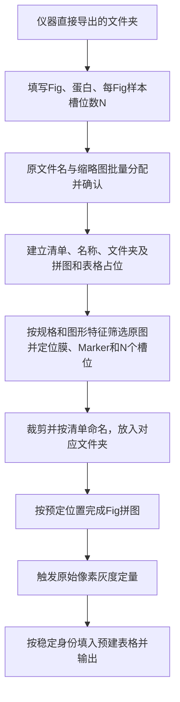

# WB 开发规划 v2：清单驱动的仪器原图自动流程

2026-10-19，T-050。本文更新WB的目标流程和下一阶段实施顺序；**规划已形成，产品尚未按本规划改造**。已确认需求与待审建议分开列出，不把建议当用户决定。

最初[技术方案PDF](../生物图像工具平台与全AI长期迭代技术方案.pdf)保留不动，本文是增量修订。原方案第6–9节的原图保护、版本化、异步任务与状态分离继续适用。原先“生成拼图→OCR还原Fig/蛋白→关联结果”的主路径，被本次明确的清单传递取代。既有OCR及历史读取能力的保留方式见待审建议。

本文以本地产品提交 `a23435471742b69adbc800bad0b1b8fe58872bd3` 做只读审计；GitHub main基线 `221a2dff610554092a881fc396010f032b31ae33` 尚未集成后续产品分支。因此本文提到的现有模块不表示它们已在main，也不因文档PR通过而宣称产品验收。

## 1. 已确认的目标流程



- N是每个Fig内各蛋白图共同的**横向样本槽位数，包含无可见信号的空位，不包含Marker**；不能用检测到的峰数替代N。
- 实验室人员通过原名与缩略图批量分配Fig/蛋白，并确认对应关系；不靠不明仪器编号猜身份。
- 输入信息建立后，裁剪文件名、输出目录、拼图位置、注释及结果表均由同一清单生成；不在每一步重新输入或从图片OCR提取。
- 界面顺序是先拼图、再定量；数值从对应原图的原始像素和ROI计算，不读取已缩放、拉正、带注释的拼图像素。
- 仅输入Fig/蛋白/N时即可建立内部结果表结构，数值初始为空并标待计算；运行提交成功后填值，不能预填0冒充结果。最终表格在定量后直接输出。

## 2. 每一步的输入、输出及人员操作

| 步骤 | 自动处理与输出 | 人员操作/缺口 |
|---|---|---|
| 扫描 | 只读枚举支持文件，取得原名、尺寸/位深、缩略图及来源身份 | 选择仪器导出目录；不修改源文件 |
| 清单 | 为Fig、蛋白行和1…N槽位建立稳定ID | 填Fig/蛋白/N，批量分配图片并确认；同名蛋白可以是不同的行 |
| 对齐与计划 | 校验分配，生成名称、目标路径、布局占位和表格键 | 多曝光、多候选或同图多区域不得静默任选；需要明确绑定 |
| 筛选与定位 | 根据规格、来源用途及图形特征筛选，保存入选/排除原因；定位膜、Marker及槽位坐标 | 检测不确定的例外处理方案待审；已分配图片不能因筛选失败而从清单消失 |
| 裁剪 | 保存原坐标、原值裁剪及显示产物，并放入规划的Fig/蛋白位置 | 有必要时修正定位，旧自动结果保留来源 |
| 拼图 | 从清单取Fig/蛋白/顺序/注释，裁剪到位后填入布局 | 不依赖OCR；空位和未完成行不能向前挤占其他身份 |
| 定量 | 拼图就绪后提交原像素测量；结果带源、修订、行、槽位身份 | 数值质量异常不由“拼图完成”自动豁免 |
| 表格 | 以身份键填入真实结果、状态和来源，输出CSV/XLSX | 归一化如需开展，仍须显式实验配对；本次不凭蛋白名推断内参 |

“自动对齐名称”指建立确认后的来源映射并生成派生命名，不是覆写仪器原文件名。输出目录位置、名称样式及歧义确认方式在第5节给出可审核建议。

## 3. 固定N与空槽定位

固定N解决的是**槽位数量与顺序不会因信号缺失而减少**，并不单独证明空槽坐标已正确定位。定位还需膜/Marker、可见泳道与可靠的边界或间距证据；Marker提供方向/参考，但不必然单独确定所有样本槽位。

规划要求：先确定N个几何槽位，再记录每槽信号状态。中间空、首尾空、连续空、弱信号、全部无信号、无Marker、不等距、斜膜和不同蛋白图位置偏移均纳入验收；不把“在可见峰之间插空”作为首尾空槽已解决的证明。同Fig已确认共享N；跨蛋白的样本顺序是否一致仍待确认，不能从相同N推定。即使样本顺序一致，也不未经验证复用同一套像素坐标。

- 无可见信号、明确未上样、检测失败、缺图、用户排除和真实测量零值分别记录。
- 槽位几何可靠但无明显信号时保留原图区域与槽位，不直接填0；能否输出有效定量值遵守冻结的测量/背景/质量规则。
- 全空或证据不足时不能凭N均分后宣布定位成功；候选几何必须显式标记并允许复核。
- 实验趋势、预期差异或分组结果不参与定位/边界调优。

## 4. 同一清单贯穿全链

以下为建议的数据职责，不是已发布schema；实施时基于现有项目版本扩展，编号由独立契约任务决定。

| 对象 | 必须保存的身份/信息 | 使用者 |
|---|---|---|
| SourceAsset | 资产ID、原名、内容摘要、尺寸/位深、曝光/通道信息（已知时） | 所有步骤的来源依据 |
| FigPlan | Fig ID/显示名、N、蛋白行顺序、槽位1…N及可选样本标签 | 定位、拼图、表格 |
| ProteinRow | 行ID、蛋白显示名、来源绑定、区域/曝光选择 | 裁剪、测量与显示 |
| SlotGeometry | 行ID、slot ID、原图坐标、Marker/方向/间距证据、版本和复核状态 | 原值裁剪与定量 |
| LayoutPlan / TablePlan | 行/slot ID到显示位置或单元格的映射 | 预分配与后续填充 |
| StageArtifact / Measurement | 冻结修订、输入摘要、算法/参数版本、运行证据、输出及状态 | 缓存、恢复、结果提交 |

相同名称允许重复，身份不能靠名称、数组顺序或最终文件路径拼接。标签/版式修改不应触发无关数值重算；源图、N、槽位几何或测量参数变化必须让相关结果过期。改变Fig归属或样本顺序会改变关联，须重新验证布局/表格映射，即使数值本身可复用。

## 5. 提交用户审核的改进建议（未批准前不实施）

**S1：开始前一次确认，异常只暂停相关图片。** 完成清单/来源绑定后显示运行摘要，确认后自动运行；定位不确定、缺文件或多曝光冲突进入异常清单，其他已确认行继续。同Fig未完成时保留占位，不能标记完整成图。本建议以每个Fig完整拼图就绪作为其定量触发边界：同Fig缺图时，其他行可继续裁剪并等待，其他已完整Fig可继续。表格可以有带状态的部分结果，但不能将部分完成写成整批成功；此局部续作方式仍待用户审核。

**S2：在独立结果根目录自动命名和归档。** 保留仪器文件不动；每次运行新建目录，按Fig/蛋白稳定ID处理重名、非法路径字符和不同曝光。示意（名称格式可调整）：

```text
结果_批次_修订/
  清单.json
  Fig01__fig-id/
    蛋白A__row-id/原值裁剪.tiff、显示裁剪.png、来源.json
    Fig01_拼图.tiff
  定量结果.xlsx
  定量结果.csv
  处理状态.json
```

所有路径由受限的输出适配器生成，禁止把输入标签直接当任意路径。已完成结果不覆盖；失败中间件不被索引为成功；原值与显示产物分别标明用途。导出位置不成为身份权威。

**S3：新主流程不装载OCR，旧拼图识别作为可选兼容能力。** 用户已确认新流程不调用OCR；是否将OCR模型和推理依赖从基础安装包中拆出，另待审核。历史项目的读取、已保存OCR证据和既有手工定量须保留，不能为减体积静默删除旧能力或改写结果。

以上建议进入规划供审核，不作为新的操作授权或发布决定。仪器格式能力、多曝光选择、重复蛋白/多区域来源、无可靠定位证据的确认方式，需用未经整理的真实批次定下细节。

## 6. 代码结构收敛计划

维持现有 `wb_tool.api`、domain/application/adapters/ui 和宿主/存储边界，不为此新建通用工作流平台或空公共包。下面文件名是建议职责名，实施时优先合并现有实现，不要求机械新增同名文件。

| 层 | 收敛目标 | 现有复用点/需调整点 |
|---|---|---|
| WB domain | 纯数据的清单/固定槽位约束与定位输出；算法不读UI状态 | 自动几何、LaneROI、数值积分继续复用；N显式传入首轮定位 |
| WB application | 单一计划构建器：来源绑定→裁剪/布局/表格计划；单一阶段用例接口 | 复用figure_project、project_metadata、project_analysis、laboratory_layout；不再从OCR重建已知信息 |
| WB adapters | 原图读取、裁剪、命名、模板编码、表格写出各司其职 | TIFF、crop_return、figure_export、automatic_export、project_tables等；复用同一冻结渲染 |
| desktop宿主 | 一个新主流程协调器，只负责阶段推进/取消/提交；UI仅展示清单和例外 | 改造AutomaticWorkflow；复用ProjectMeasurementSession、RunSession、AsyncStorage，不新增第二套成功收据 |
| 兼容入口 | 旧单图手动/已有拼图OCR作为显式适配入口，汇入共用测量/表格 | 保留历史schema读取和证据核验；兼容逻辑不参与新主流程默认决策 |

### 算法与状态保持可审计

- 每个新主流程阶段只选一个明确默认策略，保存策略ID和版本；失败不能静默串试旧算法并挑一个“看起来成功”的结果。
- 计划草稿、检测建议、人工修订、运行快照与完成结果分开；运行快照提交即冻结，已完成结果保持不可变，后续编辑生成新修订。UI当前选中项不是算法参数来源。
- 纯重构与数值/默认值改变分开提交。旧项目按原算法/参数解释，新结果显式采用新版本；迁移备份、旧读取、重开、再次导出均须测试。
- 首版按图像/阶段完成记录恢复，未完整提交的阶段重新执行；不声称任意算法中途可续算。
- 移除重复代码前列消费者和兼容矩阵，先将入口汇合、完成回归，再淘汰无消费者路径。保持手动修正能力及原历史失败记录。

## 7. 体积与运行成本优化

先做基线再设目标；不承诺未经实测的缩减百分比。按“低风险复用→依赖裁剪→发行验证”顺序实施，不以删除来源校验和历史兼容换速度。

本机T048安装包为361,325,507字节；打包目录去除Python运行缓存后为1,095,924,700字节，四个产品包源码约1.34 MiB。主要空间来自Qt及图像/推理依赖，整理业务代码不等于显著减小安装体积。统计方法和限制见本次证据。

1. **一次渲染多处使用。** 当前自动导出分别生成PNG、TIFF、ZIP后再刷新预览，存在重复渲染。按同一冻结修订共用FigureRender/来源清单，分别编码；保留各文件写后读取校验。
2. **有界解码与任务复用。** 每源按SHA、平面、解码策略建立受内存预算限制的只读缓存；原值与显示缓存分开。几何/测量/布局使用不同依赖键，改标签只更新命名/拼图/表格。先测量进程启动、解码和编码耗时，不直接改成长驻worker或扩大并发。
3. **OCR依赖分离（S3待审）。** 工具已有可选OCR extra，但桌面依赖当前把它带入。审查完整依赖图及导入路径后，独立变更基础/兼容发行清单与锁文件，并验证离线安装和历史项目。
4. **打包按真实运行依赖裁剪。** 当前网页桌面需要QtWebEngine，不能直接移除。对Qt工具/开发资源及可选插件逐项验证；NumPy、SciPy和图像库若被核心算法使用则不能因体积大删除。
5. **可复验指标。** 同一批次与硬件记录安装包/解压后字节数、冷启动、各阶段时间、峰值RSS、取消延迟、解码/渲染次数。优化前后原值/来源/数值一致性及退出行为须通过。源码减少与安装体积减少分别报告。

## 8. 实施里程碑与验收

| 顺序 | 工作包 | 完成标准 |
|---|---|---|
| M0 | 真实仪器导出批次与清单交互 | 原名/缩略图分配Fig蛋白N，重复名/多曝光/缺图有明确处理；来源可追溯；用户审核S1–S3 |
| M1 | 清单、稳定身份和规划器 | 一次输入生成目标路径、布局占位、表格结构；改名不丢来源；保存重开一致；不调用OCR |
| M2 | 固定N定位与原值裁剪 | 已知像素反例及独立真实留出覆盖首/中/尾空、连续空、全空、弱带、缺Marker；可靠时固定N不移位，不可靠时明确待处理 |
| M3 | 裁图填位与拼图后定量 | 命名/目录/注释取同一清单；成图事件后才触发测量；数值只取原图；跨图/空槽不串结果 |
| M4 | 自动表格、部分失败与恢复 | 待计算为空，真实0与失败区分；只给对应身份填值；每阶段取消/坏图/磁盘失败/重启不覆盖已有结果、不假成功 |
| M5 | 结构/依赖收敛与包态验收 | 重复渲染减少，量化前后成本；旧schema/OCR兼容、独立wheel/全门禁/绑定提交独审；真实安装版流程验证 |

M0–M5为规划工作包，不占用尚未创建的任务编号。先完成一份仪器原始批次的纵向闭环，再扩大图片范围。旧整理文件夹只作回归，不作仪器适配完成证据；合成技术用例不能替代真实定位准确率。干净Windows/DPI/原生稳定性缺口独立保留，发布另按授权执行。

## 9. 当前审计与证据入口

[本次审计与验证](../work/evidence/T-050/validation.md)、[任务状态](../work/tasks/T-050-metadata-first-plan.md)。产品源事实按审计提交核对，不把既有测试数量写成新流程通过。本文无代码、算法、schema、依赖、锁文件或门禁修改。
