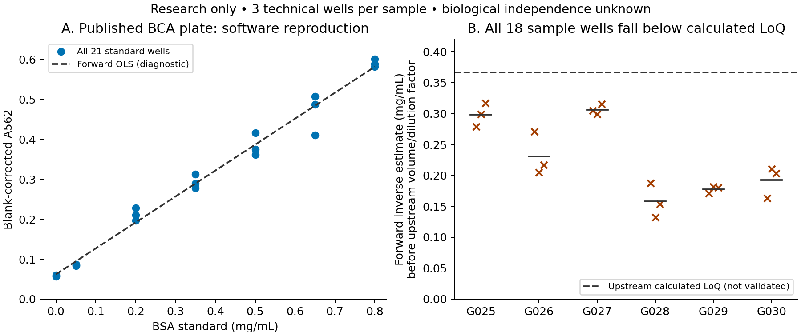

# P017 研究复现入口

结论及学生操作链见[短实验说明](../../../docs/research/2026-11-06-endpoint-assay.md)。[预声明](experiment-plan.md)先于拟合提交；[来源清单](source-manifest.json)固定上游提交、路径/字节数/SHA256；[依赖](requirements.txt)仅属于本研究独立环境，不改产品锁。

## 重现

从仓库根运行（Windows PowerShell；Python3.12.14/uv）。下载是公开输入，不执行下载的R源码。使用新的输出目录，拒绝覆盖。

```powershell
uv venv .local/p017-reproduce --python 3.12
uv pip install --python .local/p017-reproduce/Scripts/python.exe -r work/evidence/P-017/requirements.txt
.local/p017-reproduce/Scripts/python.exe work/evidence/P-017/fetch_sources.py .local/p017-sources
.local/p017-reproduce/Scripts/python.exe work/evidence/P-017/run_probe.py .local/p017-sources .local/p017-reproduced
.local/p017-reproduce/Scripts/python.exe work/evidence/P-017/plot_probe.py .local/p017-reproduced .local/p017-reproduced/figure.png
```

网络下载可按同一命令重试，已存在文件须摘要一致；不忽略TLS或摘要错误。全部数据和发布参考来自[plateReadeR固定版本](https://github.com/mdc-science/plateReadeR/tree/cfb05bd403747b3192999debe9889fa5d1fefb78)，作者Daniel Moreira，仓库MIT；未找到独立数据许可声明。此仓库不重新打包上游原始XLSX/R源码，只保留来源/摘要及本研究分析派生表；未来若随产品分发完整例数据，须进一步明确数据再分发范围。原文件仅本地下载。

## 实测

- 环境：Windows11 build26200、Python3.12.14，CPU；numpy2.5.4/scipy1.18.1/statsmodels0.14.4/pandas2.2.3/openpyxl3.1.5，图matplotlib3.10.8。具体传递版本见requirements。
- 初次run1退出1：数值对照已通过，但常量x异常预期不符（SciPy返回NaN和RuntimeWarning）。保留失败，随后只修正探针去记录真实失败语义，未改变数据/容差/模型。run2退出0，读取/拟合/导出0.1203秒，不含导入/下载；未测峰值内存、目标机、R全流程或学生耗时。
- 运行两种成熟公开回归API，不自行求解、不称运行了plateReadeR/FPCountR。6样本参考最大差1.78e-15 mg/mL。NaN输入明确抛错；常量x返回NaN须由调用入口拒绝。
- [逐定义孔](results/all-defined-wells.csv)：42孔原值与空白扣除；[标准/残差](results/standards.csv)；[18样本孔](results/sample-wells.csv)：正/反向诊断浓度与标记；[6样本汇总](results/samples.csv)：技术n/SD、软件参考差异；[机器收据](results/result.json)。mg/mL与标准坐标明确，样本体积修正只为复现。
- R下载CRAN90秒与清华镜像60秒均超时退出28；未安装R、未运行R源码。git clone长时间无进度停止，仅停止本次已核实命令的进程；改为固定GitHub raw文件下载，一文件SSL EOF后gh API重取成功。旧环境/产品进程未触碰。
- 隔离安装初选旧SciPy需额外下载；在运行前换成本机已有固定1.18.1并记录完整版本；没有产品依赖变更。增加matplotlib仅为研究图。



图为1800×756 PNG，10×4.2英寸、180dpi的通用研究说明图，无期刊合规声明。左：21个标准孔与正向OLS虚线，未删点；右：18个技术孔，横短线为各样本3孔均值，横向偏移仅帮助辨认。虚线是上游计算LoQ，未获化学验证；没有生物置信区间/显著性。全部样本孔低于该计算LoQ，不能从extrapolated=false宣布质量通过。图已实际打开核对，文字/点/图例可见。

## 检查与交付状态

本轮为研究与B020规划集成，无产品代码/产品锁/门禁改变。指定独审bcf57ce已通过研究/规划范围，原文及独立复算收据见[审查收据](review-and-validation.md)；最终增量确认、规则/计划/政策检查及正常PR必需CI以[审查收据](review-and-validation.md)和任务卡记录，未完成前不声称已集成。P016 ac10a07收尾、B020 e4209e9保留随本PR带入。MVP先行，完整版集中统一前端；按主方案第11节区分工程MVP、统一交互、运行候选、用户安装更新、科学/真人试用。
