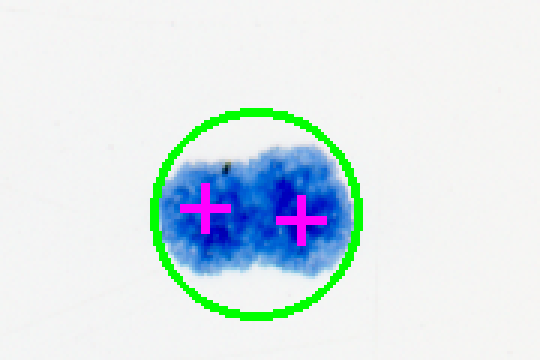

# P031 复验

从仓库根目录在 Windows PowerShell 执行。需要 Git、uv、Python 3.11、约 1 GB 可用空间和可访问 Zenodo/GitHub/PyPI 的网络。在仓库外新建研究目录；不更改平台锁文件。源归档下载较慢时可分段下载同一文件，脚本在解包前验证完整归档的发布者 MD5。只提取 3 个 TIFF 和 12 个参考坐标文件。重放目录必须不存在。

```powershell
$proof = (Resolve-Path work/evidence/P-031/replay.py).Path
$run = Join-Path $env:TEMP ('p031-' + [guid]::NewGuid())
New-Item -ItemType Directory $run | Out-Null
Push-Location $run
curl.exe -fL -o Dataset1_T47D.zip https://zenodo.org/api/records/4593510/files/Dataset1_T47D.zip/content
git clone https://github.com/Nima-Sarfaraz/SoftCount SoftCount
git -C SoftCount checkout --detach 4c4c3de0521dda51f4bc0cd466bc4ded1003488c
uv venv --python 3.11 venv
uv pip install --python venv/Scripts/python.exe ./SoftCount
& ./venv/Scripts/python.exe $proof Dataset1_T47D.zip run
Pop-Location
```

Windows、CPython 3.11.15、SoftCount 1.0.2、NumPy 2.2.6、Pillow 12.3.0、OpenCV headless 4.13.0.92。归档 478985743 字节，MD5 1d45b5a3bd7c50c80e628ab4cb664445。初次整包限时传输超时，按 8 MiB HTTP Range 获取并校验 Content-Range，重组后整包摘要匹配。实际 CLI [输出](counts.csv)，独立的显微和观察者逐瓶计数由脚本直接读取。官方 CLI、同一版本引擎回读和轮廓核对的完整重放退出 0。全尺寸叠图及轮廓表生成于 run。图中坐标直接使用作者 x,y；来源未声明零基/一基，近边界约一个像素的不确定性保留。



C2 原坐标框 (350,840) 至 (530,960)，取自回放生成的 C2-overlay.png，再按最近邻放大三倍；左上原点，右、下为正方向。绿色算法圈、洋红显微中心，两点均在同一获计轮廓内。图源 Arous 等，2021，CC BY 4.0，已裁切、叠标与放大。[数据与作者](https://doi.org/10.5281/zenodo.4593510) · [完整研究](../../../docs/research/2026-11-09-clonogenic-count.md)

