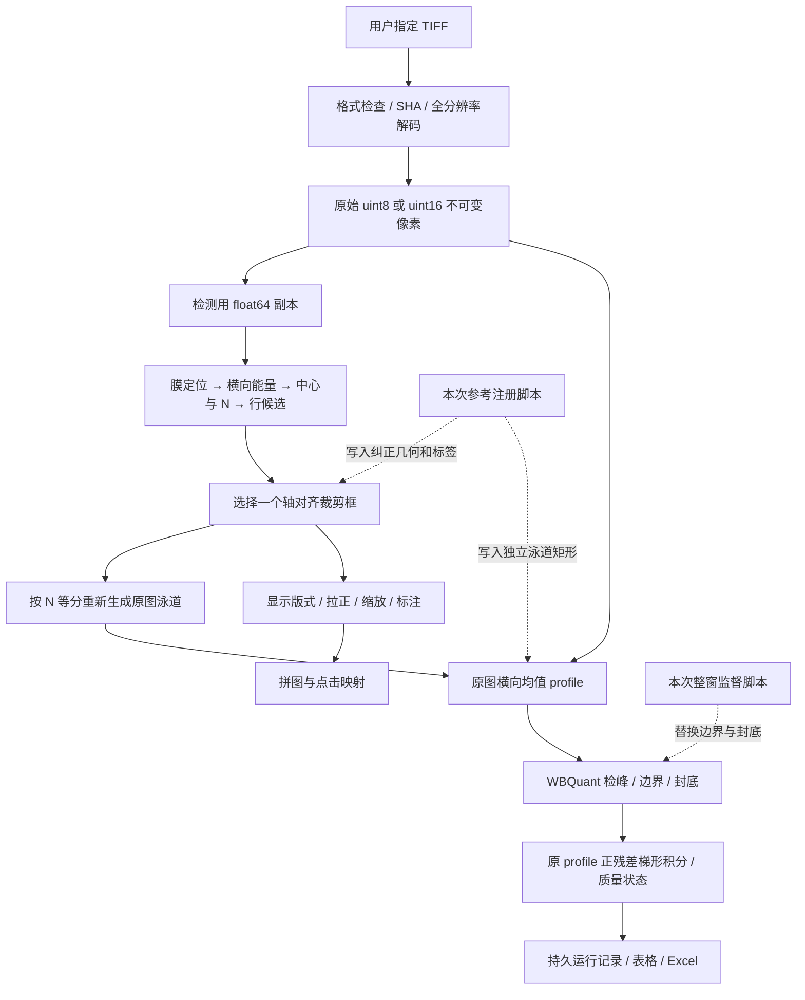

# WB 自动化全链路深度技术限制报告

日期：2026-10-17。审计工作树：`codex/t040-real-fig-validation`，HEAD `cc626d7`；产品实现截至 `f7a6651`。本报告是代码与真实失败证据审计，不是一次算法修复或新的科学验收。报告中的“原图”指用户指定 TIFF 文件，不代表已经证明它就是未经仪器处理的传感器原始计数。

## 1. 先说明实际完成到了哪里

当前系统已经具备不可变输入、原像素测量、Fig 编排、曲线监督、状态表、Excel 与可恢复项目导出等工程能力。但它尚不具备在本次真实数据上可靠地自主完成“选择正确来源→找到正确条带→自动识别样本数→自动分组标注→正确封底→可信定量”的完整能力。

本次结果分为三个阶段，不能合并为一次自动成功：

| 阶段 | 输入与干预 | 实际结果 | 可以证明什么 |
|---|---|---|---|
| 首轮自动 | 八张指定 `(1).tiff`，未使用验证图几何 | 严格裁图正确 1/8，12.5% | 当前自动算法在这组图上的真实不足 |
| 参考辅助纠正 | 本地脚本读取正确参考图，注册旋转、尺度、位置，并写入 N、Fig、蛋白、原图泳道矩形与显示框 | 八张纠正裁图逐图检查通过，四组 Fig 成图 | 已知正确参考条件下，几何纠正和工作台消费这些数据可运行；不能证明自主识别 |
| 监督积分修正 | 脚本把已经隔离目标的每个泳道窗口设为完整积分范围，封底连接首尾样本 | 48 个修正版观察积分、Excel、CSV、ZIP | 原图像素到所声明积分公式及导出的数值一致性；不能证明自动边界、线性丰度或生物结论 |

`(1)` 文件过滤、蛋白名推导、四个 Fig 的配置、960×1200N 单图回原目录、冲突后加版本名，在这次交付中有本地脚本的专门逻辑，不能当作普通产品入口已经全部支持。最终运行的确使用真实工作台、后台测量、保存和导出；但准备项目所需的正确几何与标签不是该入口独立推断出来的。之前“完整跑通”的表述若让人理解为已实现端到端自主自动化，范围就说大了。

主要证据：`.local/t040/first-automatic.json`、`audit/reference-audit.md`、`audit/corrected-registration.json`、`audit/profile-audit.json`、`.local/t040_finish.py`、`.local/t040_supervise.py`、`delivery-report.json`。私有图像和数组保留在本地，不进入仓库。

首轮逐图定位如下。细化膜、N规则的重放可以定位失败路径；正确性仍按独立参考审计的“目标行、N、完整性、无Marker/邻行”联合判定，不凭候选数量评分。

| 图 | 原图W×H/位深 | 正确N / 首轮N | 首轮判定与主要机制 |
|---|---|---|---|
| 1D ABCA9 |1496×1500 /8|8 /1|失败；短膜门槛拒绝→全图回退→大框含整膜/Marker |
| 1D β-actin |1496×1500 /8|8 /7|失败；原找到8中心，倾斜触发Marker误删；框截带 |
| 1F ABCA9 |2992×3000 /16|4 /4|通过本次四项裁图标准；不是完整定量成功证明 |
| 1F β-actin |1496×1500 /8|4 /1|失败；短膜门槛拒绝→全图回退 |
| 4F NSUN6 |1496×1500 /8|8 /1|失败；短膜门槛拒绝→全图回退 |
| 4F β-actin |2992×3000 /16|8 /7|失败；原找到8中心，Marker误删首样本；框截带 |
| 4H NSUN6 |2992×3000 /16|4 /2|失败；四段等距条件拒绝，回退两段；覆盖不完整 |
| 4H β-actin |2992×3000 /8|4 /4|失败；N对但水平框截断倾斜两端 |

## 2. 全链路如何传递数据

下图表示数据依赖，**不是当前执行时序图**；现有自动编排先测量、后成图的问题见第13节。



两个重要隔离是正确的：显示像素不进入积分；结果保存携带来源与修订。但隔离只能避免“算错来源”，不能保证“选对目标或边界”。SHA、事务、schema 和 Excel 一致性都无法证明检测是科学正确的。

## 3. TIFF 输入、位深与“没有压缩原图”的准确含义

本次八张源文件有两种采样尺寸：1496×1500 和 2992×3000；五张 uint8、三张 uint16。软件读取文件中的原尺寸与样本值，并未先把原图缩到网页预览尺寸后再做定量。源文件及验证文件 SHA 在处理前后相同。

原图不可变、检测副本、显示图是三种不同数据：

- 原图样本：后续积分读取这些整数值。
- 检测副本：可转 float64、平滑、估计背景；这些值只用于提出坐标。
- 标准展示图：可以拉正、插值、缩放到高960和宽1200N；保持 uint16 容器不代表样本仍逐像素等于原图，也不意味着增加了真实分辨率。

“不压缩原图”不能解释为标准裁图没有重采样。源文件确实保留；统一展示图确实经过几何变换。将一张较小原图输出成9600×960，只得到更多插值样本，不会得到更多仪器测量信息。

读取器仅接受单页、左上方向、规定色度和无符号8/16位TIFF；RGBA必须完全不透明。RGB转换使用整数BT.601：`(299R+587G+114B+500)//1000`。MINISWHITE不会自动反相，需要核对极性。合法TIFF不等于所有TIFF都可检测。

一个不能忽略的工程限制是：读取器在`page.asarray()`完整解码前没有统一像素/解码字节硬上限。自动检测的1600万像素限制发生在读取之后，不能防止超大输入先消耗内存。RGB转换还会创建uint32工作数组；原图、灰度数组、bytes不可变副本、多个float64平滑/累积数组可能同时存在。以2992×3000计算，单个float64平面约71.8MB，完整算法同时有多个平面；本轮没有测峰值RSS，不能把支持一张图推广为大批内存验收。

原图预览有stride降采样，uint16预览还会`//257`转8位，常用预览上限2048、导入缩略图128。这影响屏幕外观，不覆盖原图；后续测量从源资产重新全分辨率读取。所谓“逐源一次解码”只保证一次拼图渲染内部的复用，不代表整个导入、检测、测量、导出全过程只读一次。全文件SHA也会重复读取磁盘。8位与16位数据不能仅凭数字大小直接混比。

## 4. 自动定位第一步：先找膜，不是直接识别蛋白

现行自动裁图是确定性图像启发式，没有训练好的蛋白识别模型，也没有读取分子量知识来决定哪行是目标蛋白。

膜定位函数先从原图按步长抽样，使最长边约不超过256个采样点：`step=ceil(max(H,W)/256)`。这是定位加速用的抽样，不是替换测量原图。该步骤仍有损失小结构、弱边界和细缝的可能。

它取抽样图四周边界值的中位数作背景估计，计算每点与该值的绝对距离。再依据256桶直方图的类间方差阈值和边界噪声门槛分割，做连接域提取。保留面积至少占抽样图1%、且填充率至少约55%的组件。最大组件作为主膜；若其他大组件也明显，则留下多膜警告。

这一设计假设：膜与背景有明显强度差；图像四周具有代表性的背景；膜是较大的近实心连接区域。边缘出现文字、反光、裁切、白背景与膜接近、组件断裂或多膜时，该假设可能失败。它识别的是“与边界背景不同的大块区域”，没有证明该块一定是正确膜。

随后又按行、列投影，以最大占有量的50%作细化，得到轴对齐膜矩形。倾斜长方形的两端角部占有量偏低，因而会被这一细化删去；它没有保留旋转矩形或完整膜轮廓供后续恢复角度。

还有一个明确的参数耦合：细化膜高度小于 `2×crop_height` 即判边界不清。默认 `crop_height=60`，最低膜高因此为120原像素。本次同源重放只把这一参数从60改为2，读到的细化高度分别为107、124、245、119、118、250、239、265。发生全图回退的三张是107、119、118，恰好都低于120。之前诊断中提到的约113来自另一实验几何，并不是产品细化膜高，不能混用。

这说明三张图的回退首先是可定位的规则缺陷，并非源图不存在膜，也不是因为软件把输入压缩了。

代码：`tools/wb/src/wb_tool/domain/crop_detection.py` 的 `_membrane`；当前自主入口由 `domain/automatic.py` 调用该膜定位函数。

## 5. 第二步：生成检测信号与横向条带能量

找不到可靠膜时，当前自动分支不会就此停止，而是把整张图当膜继续处理，并加 `full_image_detection_fallback` 警告。这会把明显异常的定位结果继续传给后面的候选生成。

在膜范围内，原像素转为 float64。用沿纵向的盒式平滑估计背景，半径为 `max(2,crop_height)`，窗口长为 `2r+1`，边界采用复制。黑带信号取 `背景−原值`，亮带反向，再用半径1平滑。这不是二维背景曲面拟合，也没有先校正膜倾斜。

噪声用沿纵向相邻差分的 MAD 估计：`sigma=max(1, median(abs(diff−median(diff)))/0.9538725524)`。最低值1是原样本强度单位，不是统一百分比，因此不同位深和仪器映射下，该下限的相对意义不同。

若此前膜带警告，先取`guard=min(max(2,crop_height//4),H//8)`，只保留`interior=S[guard:H−guard]`；无警告时使用全部S。随后每个横坐标x取纵向正信号的95%分位数：`E(x)=Q95_y(max(interior(y,x),0))`。然后沿x平滑，清掉左右各约1%的边缘。上下保护发生在列投影之前。

这个分位数有一个直接限制：条带在整列中只占很少的高度时，Q95可能主要反映背景。膜定位正常时条带占比尚可；一旦回退成整幅1500/3000像素高的大图，条带高度远小于总高的5%，关键结构可能被压掉，或黑边与大范围边缘反而主导。上游一次失败因此会级联成 N 和裁框错误。

## 6. 第三步：由连接段推中心，再推泳道数 N

当前自主分支依次尝试能量最大值的0.35、0.5、0.65、0.8、0.9五档阈值，同时要求超过 `min_snr×noise`，默认 `min_snr=4`。对超过阈值的一维区段提取连接段，只留宽度至少 `max(2,膜宽/40取整)` 的段。每段能量加权中心就是一个候选条带中心。

若某阈值至少得到3个中心，还要求：相邻中心间距的变异系数小于0.15；最窄段宽度不小于中位中心间距的0.4。多个合格阈值中选中心数最多的那个。若没有合格阈值，则硬回退到0.5档，而不是综合所有阈值的证据。

这不是完整的泳道结构推断。它对宽度、等距程度、阈值下的连接性有强假设：宽带粘连会从两段变一段；弱带会消失；不均匀间距会让正确中心集合被淘汰。即使没有空条带，仍然可能失败。

本次4H NSUN6在0.35档确实得到4段，中心约141.31、350.39、451.13、658.19；间距变异系数0.29368，大于0.15，因此整组被拒绝。宽度条件本来通过。所有档都没有合格的三中心以上组合，回退0.5后只剩两个中心，最终 N=2。这是“已有四段被规则淘汰再回退丢失”，不能解释成原图只有两个条带。

最终 N 的估算为：`pitch=median(diff(centers))`，`N=round((last−first)/pitch)+1`，最多96。它能补某些内部缺槽，但不能可靠推断两端看不见的槽；两个不同真实 N 可能产生相同可见中心，单张图在这种情况下本来就不可辨识。

仓库还存在已知 N 的旧候选检测 `_sample_grid` / 周期网格路径；其参数与能力不能拿来描述当前自主 N 的这条分支。当前桌面采用 `lane_ratio@1` 和 `wbquant_1_4_3@1`，不是把旧手动指定 N 检测原样作为自主算法。

## 7. Marker 是怎样误删真实泳道的

`left_marker=auto` 时，至少有3个中心才尝试判断：第一个中心须位于膜宽前28%，并且它的纵向峰位置与其他中心纵向峰的中位数相差大于 `max(4,0.15×crop_height)`。默认裁高60，纵向差门槛就是9像素。满足就删掉第一个中心，认为它是左 Marker。

这一规则没有识别 Marker 的多条梯状结构，也未先去掉倾斜趋势。因此斜着排列的一整行真实样本会沿 x 系统性改变 y；第一个样本离其他样本中位 y 足够远，就可能被误删。

本次原逻辑重放明确得到：

| 图 | Marker 判断前 | 触发条件 | 后果 |
|---|---|---|---|
| 1D β-actin | 阈值阶段找到8中心；首中心约106.9 | 首中心<145.04；纵向差17>9 | 删除真实第1泳道，N变7 |
| 4F β-actin | 阈值阶段找到8中心；首中心约220.1 | 首中心<289.24；纵向差20>9 | 删除真实第1泳道，N变7 |
| 4H β-actin | 先找到5中心，确有左Marker | 首段与后面样本高度差很大 | 删后N=4，但水平裁框仍截断斜带 |

所以这两张 N=7 的直接原因已不是泛泛的“弱带漏检”，而是倾斜与 Marker 判定之间的系统性冲突。简单把阈值调低不会修复这一误删。Marker 决策需要去趋势后的几何、多行证据或显式样本布局约束。

## 8. 第四步：怎样找到条带行、怎样生成裁剪框

确定左右样本范围后，算法将范围按 N 等宽分成纵向条形泳道。每条对检测信号沿 x 求均值得到纵向曲线，再除以噪声估计形成 SNR。某一 y 行至少有 `ceil(0.4N)` 个泳道达到 SNR4，才算活跃；门槛至少为1。

连续活跃 y 合并为区段；相邻区段间隙不超过 `max(1,crop_height/12取整)` 时再合并。默认60时可合并相隔5像素的活动。每段内用截顶到20的泳道 SNR 总和作为权重，取 y 的加权中心。它不是在逐个条带外轮廓上做精确分割。

先给出中心附近固定高60的框。`lane_ratio@1` 再改成整数舍入后的宽高比 `W/H≈1.25N`：

```
H = max(2, ceil(样本横向宽度 × 4 / (5N)), 活跃段高 + 4)
W = round_half_up(5N × H / 4)
```

框在图内平移以避免越界；若宽高超过源图或不能覆盖所选活跃段，则拒绝该候选。它保证的是轴对齐矩形在舍入容差内的比例和所选活跃段覆盖，不保证已经找到了所有真实带，不保证框里没有 Marker/邻行，也不保证倾斜首尾完整。若 N 先被错估为1，维持比例的结果就可能是一个高达数百像素的大框：1D ABCA9首候选实际808×646，正是错误 N 传递到裁框尺寸的结果。

候选按“检出的泳道数最多→截顶SNR总和最高→纵向更靠上”排序，最多保留8个；下游自动路径通常使用首候选。这是工程排序，不是蛋白身份或正确目标行的概率模型。多条真实蛋白行共存时，没有分子量/实验指令就不能保证最强行是目标行。

另一个静态设计问题：候选强度来自比例扩框之前的网格；最终定量请求又把比例扩框之后的 ROI 按 N 重新等分。代码没有要求这两个网格仍对齐原条带中心。多加左右边距或扩大高度都会改变最终槽宽。此项是由代码直接推出的几何风险，本轮没有把它单独量化为七张失败中的某个比例。

修改 n 的快速宽度调整是另一条明确规则：保留当前原图高度和中心，取 `W≈1.25nH`，越界时拒绝而不是裁掉一部分。它没有重新识别条带，也不能验证用户填的 n 正确；显示图框与定量泳道需要随修订一起更新。

## 9. 为什么水平框无法完整解决倾斜膜

一条宽 W、倾角 θ 的行，其两端高度差约 `W×tan(θ)`。即使每条带很薄，大范围水平框也要包含整行倾斜造成的高度差；强行保持很矮的框会截断两端，增高又可能带入背景或邻行。

当前自主裁图没有估计旋转角、没有弯曲膜模型，也没有按泳道单独平移 y。已有诊断中直接旋转再扫描阈值，仍不能一致恢复正确 N。旋转是值得验证的候选步骤，单独加入尚不足以完整修复；本轮未证明所有场景必须采用该方法。

本次参考纠正用的是正确裁图作为模板，搜索角度、位置和尺度，以归一化相关系数选择匹配，NCC约0.99786–0.99977。N与蛋白/组信息也来自已确认结构。高相关只证明参考对应得很好，不证明不用参考还能定位，不证明像素相同，也不证明历史参考的科学处理全部可逆。

定量没有读插值拉正后的图，而是把参考框映回原图，为各泳道构造不重叠的整数 x 分区和独立 y 范围。它们仍是轴对齐矩形，不是旋转条带的精确掩膜：会包含额外三角形背景，且斜带在单泳道内仍可能使曲线展宽。避免插值并不自动等于采样区域最优。若未来改成多边形/旋转域积分，应作为新的定量语义验证与版本化，不能悄悄替换。

## 10. 灰度曲线、峰边界与封底的实际含义

**曲线与积分公式。** 对原图某泳道矩形，每个 y 对 x 求均值，黑带信号为 `P(y)=Dmax−mean_x(I(x,y))`，其中 Dmax 为255或65535；亮带使用相应正向值。它是横向均值曲线，不是整个二维带面积的像素和。泳道宽度没有再乘进 Signal。

边界为闭区间 L..R，封底连两端值：`B(y)=bL+(bR−bL)(y−L)/(R−L)`。保留正残差 `Q(y)=max(P(y)−B(y),0)`，再按纵向原像素步长1作梯形积分。单位可理解为“灰度单位×纵向像素”，没有自动换算光子数、物理面积或蛋白量。

**主检峰的实际默认。** WBQuant1.4.3使用`D=P99(profile)−P1(profile)`作为动态范围，非正时退回max−min；prominence门槛0.05D，最小峰宽3像素、峰间距5像素，默认`smoothing_sigma=0`，主检峰没有平滑。弱峰第二遍才用sigma0.8和1.4，门槛取`max(2.6×noise,0.0125D,1e−9)`、最小宽1.25、间距3；还需局部SNR≥2.5和综合分≥0.32，并以`included=False`提供建议，不自动补成有效主峰。

**边框排除是另一套判断，不是Marker识别。** 先在泳道矩形四边各搜索约8%的窄带，宽度至少6、最多64像素；以内部较低60%暗度池估背景，像素门槛综合4倍稳健噪声（稳健噪声=1.4826×MAD）、0.18倍稳健范围、满量程2.5%和至少1灰度单位。覆盖率至少72%的暗直线才进入候选，允许合并2像素缝。评分由覆盖、对比、均匀、外侧padding、距离和薄度以0.32/0.24/0.16/0.12/0.10/0.06加权，水平/竖直线共同出现再加0.06；分数≥0.78才裁掉边框并留1像素安全量，0.62..0.78仅复核。若裁后没有有效区域则撤销自动裁除。检峰后还有独立黑框峰分类及跨泳道一致性判断，配置高置信0.74、复核0.54；这些分数是经验评分，不是校准概率，也不应混作膜检测或N置信度。

真实蛋白靠边、宽饱和平台与直线黑框可能相似，边框规则存在误判风险；但本次17个严重低值重放都没有边框inset，已经排除“自动裁边框是它们共同原因”。多峰还会按纵向排序；`install_automatic_result`安装路径只保留每泳道第一个band，这并不识别哪一个是目标蛋白。`suggest_analysis_for_crop`、`propose_quant_lanes`本身及本次参考辅助脚本保留多band，不能把首band裁减泛化为所有路径。多峰目标选择必须有明确语义，不能由排序代替。

**为什么原公式兼容仍会失败。** WBQuant1.4.3的峰候选、边界和封底算法被保留，是为了兼容其既有行为；兼容某个算法不等于该算法对任意实际形态都正确。当前主检测默认不平滑；即使启用检峰平滑，边界和积分也仍取原曲线。带顶部轻微波动就会产生“严格局部极小”，而这些凹点并未回到背景。

“严格局部极小”的判据仅为`P[i]<P[i−1]`且`P[i]<P[i+1]`。`_outer_boundary`在`max(6,ceil(2×峰宽))`范围内优先取最近这种点，找不到才取窗口最小值。随后`_peak_connected_bounds`只能在这两个初始边界内进一步收紧，不能向外纠正。所谓`left_returned/right_returned`实际仅检查是否碰ROI外缘，并未测试连续背景稳定性。边界置信度计算为两端相对峰顶下降量/prominence的较小值，裁到0..1；它被保存，却没有作为接受门槛。

本轮追加原逻辑重放后，17个严重偏低槽全部精确复现旧值；全部只有1个 included 主峰，全部自动黑边 inset=0。共同失效点指向上述最近局部极小值规则。16/17的边界置信度低于0.1，但该数字只是本次观察范围，不是已经建立的科学阈值；低置信度在现路径中没有转化为拒绝或待复核。11/17在移植算法内部仍是 `ok` 且没有 warning，6个`needs-review`；重放应用层后则是3个`valid`、14个`quality_review`，后者由取值上下限而非边界置信度触发。注意17/48是参考辅助纠正几何后的旧峰边界结果，不是对最初错误裁图的积分统计。

例如 Fig4F β-actin泳道1，检出的主峰在 y47，峰宽约35.20，但最终边界是46..48，封底连着峰顶附近两个点，结果143.8486；同一原ROI整窗对照是1414251.1881。它不是选错另一个峰，不是Excel漏写数位，也不是该槽被黑边裁掉。原算法把35像素宽的主峰只剩3个采样点参与积分。

另例 Fig1F ABCA9泳道2，主峰51、宽约28.92，左侧最近局部极小值50被选为边界；该槽甚至没有零值像素。由此可以排除“所有偏低都只是饱和造成”这种解释。

监督修正版将已经隔离目标的原图窗口设为0..H−1并连接首尾。48个修正值与独立同口径计算一致；Excel XML复读最大误差约2.33e−10。但整窗也可能包含尾部、邻峰或背景梯度，端点若不在背景上仍会偏差。它是显式监督对照，不是新的自动真值。

## 11. 质量警告、饱和、位深与跨图比较的限制

33/48原图泳道矩形含准确0值；24个内参全部存在零值平台，约占各矩形9%–21%。这与下限裁切一致，但仅凭导出的 TIFF 不能判定发生在传感器采集、仪器映射还是更早的图像处理。无0值也不能证明曝光响应线性。

若多个真实强度被裁到同一个下限，后续只能读到相同整数，没有算法可从这一张图唯一还原此前强度。放大、拉正、全窗积分、背景扣除、AI预测均不能成为恢复真实实验信号的证据。可行的验证是采集元信息、较短曝光或稀释系列，而非把警告隐藏。

现应用把异常原始积分与有效信号区分，待复核值不能默认进入归一化。这比把失败写成0正确，但“valid”也仅代表通过现有规则，不代表已证明线性、特异性或生物学正确。应用只要在选定积分区域发现任意0或dtype最大值就加质量标记，尚未区分孤立坏点与宽平台；同时`propose_quant_lanes`没有把参考内部`needs-review`和结构化boundary_confidence完整传到应用质量状态，主要只保留bounds、baseline和文字notes。基线对象只要显式给定，`baseline_source`就可能记成`manual`，即使它由机器生成；不能拿这一字段证明人已审核。

8位与16位的积分量级不同；原图纵向采样密度不同也会影响按像素积分的量级。保持位深、统一展示高度和输出尺寸并没有完成曝光校准、相机响应校准或采样尺度校准。目标/内参一一对应、曝光关系、组内顺序均应有来源。Fig在排版上的同列不自动证明实验上同一样本。

一般科学依据：Bio-Rad技术报告5809比较了数字成像与胶片的动态范围，说明饱和后强度变化不可再测，出版用显示图还可能将较高位深映射到256级。它支持区分测量与展示、核对动态范围这一原则，不构成本图已在采集时饱和的独立证明。来源见第17节。

## 12. 拼图、960/1200N、DPI与回源监督

`native_samples@1` 保留旧显示方式；本轮新增显式 `standard_lane_ratio@1`，预览泳道单位120，对应行高96；高分辨率单位1200，对应行高960。RGB8拼图只作展示。DisplayFrame保存中心、宽高、角度并记录源到输出的仿射变换，使显示框能映回原图。

这些标准策略、lane_unit和DisplayFrame本次由脚本设置。普通网页/原生排版面板尚无完整的策略、泳道像素单位、旋转角与中心编辑控件，不能理解为用户现在可以在普通界面一键生成这些标准拉正结果。产品无frame标准缩放用LANCZOS，有frame则从RGB8副本用bilinear仿射采样；回原目录的独立标准TIFF由本地注册脚本用源dtype与INTER_CUBIC透视采样。两条展示路径的位深与插值核不同，不承诺逐像素一致。

DisplayFrame目前只允许整行1..N，不能让多个泳道分段复用同一个整行frame。此前独审发现分段声称只显示局部样本却重复采整行，已通过拒绝这类组合修复。支持“整行拉正”不等于已支持“任意分段旋转框”。

在有旋转的情况下，源矩形映到图上是四边形；网页监督框可能取其外接矩形并裁到输出框。这个框用于定位提示，不是承诺显示图上的矩形与原像素测量区域完全相同。定量请求始终以持久原图ROI为准。

还有两个新发现的边界：

1. **缩略图坐标风险（静态推导，未作为本次已发生错误）。** `ui/background.py`把过大拼图缩到2048以内时，会更新展示宽高，但manifest中的原输出坐标未同步缩放；bridge与网页若拿缩略图宽高除原坐标，框、点击和聚焦可能错位。本次总览1992×688，没有触发该分支，不能声称它造成了本次裁图失败。
2. **高分辨率脚本绕过模型验证。** 单Fig脚本用 `model_copy(update=...)` 把蛋白字号设160、标题字号设190，而模型上限分别96与128。Pydantic该更新方式不重新验证字段。已实际读取Fig1D高分辨率TIFF内嵌project，两项普通模型校验均失败；图像本身可读，不能因此称像素损坏。主保存项目字号32/34合法，ZIP不受这两个临时参数影响；这不改变48个积分，却说明单Fig高分辨率脚本不能视为普通UI参数往返已经全部验收。

像素与厘米必须分开：回原目录标准图写1200DPI时，1200像素对应2.54cm，高960对应2.032cm。如果还要求原先PS描述的每泳道1cm、高0.8cm，则相应分辨率应为3048DPI；当前模板上限1200。现已满足的是像素尺寸与比例，不能连物理厘米规格也宣称满足。是否还要求厘米，应作为规格解释明确记录，不能靠调整DPI掩盖像素或采样变化。

## 13. Fig身份、OCR、分组与普通入口的缺口

当前通用导入扫描TIFF，不会自动理解本实验“只有(1)才是待裁源图”的约定；默认各源独立Fig，蛋白为Unassigned或来源编号，避免凭图像虚构身份。这是保守行为，但与本次期望的自主工具仍有距离。

本次本地脚本根据文件夹与命名规则设置Fig1D/1F/4F/4H、ABCA9/NSUN6/β-actin及顺序。OCR没有承担本次标签与泳道身份确认，不能把最终准确标注算作OCR成功。仪器原图本身若没有Fig标签，OCR也无法凭空恢复实验组别。

应把“可配置的来源过滤和命名规则”“自动图像几何”“实验身份与对应关系”拆成三个明确步骤。前者可以使用用户已确认的命名约定，后者必须记录配置来源；不能把约定约束后的N称为完全由图像推断，也不能把蛋白文件名当作强度算法的真值。

还有一个流程差异：当前自动内核在导入和自动ROI后直接逐源测量，随后才渲染拼图/发布结果；并未按用户要求完成“裁图→分组标注成Fig→按Fig启动测量”的自动阶段编排。网页已有`quant_group`入口，可选择同Fig且同N的行逐源运行，但同N只保证列数一致，不验证不同蛋白第i列的样本身份。保留原图取样是正确的；需要补的是工作流阶段和对应关系，不能改成在RGB8拼图上积分来假装符合流程。

## 14. 持久化、Excel与CSV：正确保存不等于正确测量

工作台使用来源SHA、草稿修订、当前请求匹配、后台运行与事务提交保护，避免旧任务覆盖新草稿，避免未提交结果冒充完成。取消、关闭、过期结果有独立路径。可恢复ZIP保留输入、参数、结果及摘要；摘要只能核对一致性，不能认证实验真实性。

本次旧48值从保存ROI、边界、封底都能准确重算，证明误差发生在测量参数选择，不是导出途中改变了数字。监督Excel的48值与独立计算一致，说明该次导出忠实保留了所计算的数值；这不是生物学正确性证明。

XLSX数值单元格保存完整浮点表示，显示格式可为两位小数；WBQuant专用CSV实现则用 `:.2f` 格式化，舍入后只输出两位小数。不能继续笼统声称CSV与XLSX都保留完整精度；CSV格式化舍入会影响小信号与再计算，若要全精度需明确变更兼容策略。新版WBQuant主表显式展示有测量的原始Signal，包括待复核项，并在“状态与来源”页说明；有数字不代表能作为有效信号归一化，主表也没有用Excel公式重新执行积分。

标准显示TIFF通过Software/来源标记被本软件拒绝再次作为原图定量，但标记可被第三方移除，这不是通用图像真实性检测。未知外部TIFF的历史处理无法自动证明。文件导出成功、ZIP核验成功、无覆盖与源SHA不变，分别只证明相应工程属性。

## 15. 为什么600项测试通过仍没挡住这些问题

现有自动裁图测试大量使用等距、近水平、矩形带、理想膜边界、已知N或较简单噪声。WBQuant兼容回归使用独立1.4.3输出，但主峰也多来自生成的高斯/双峰、弱峰、平直或边框样例。它们证明实现兼容和指定不变量，不能覆盖真实倾斜膜、顶部微凹、混合采样尺度与Marker相互干扰。

几何测试和积分测试分开通过，仍可能漏掉“扩框前提取中心、扩框后重新等分”的跨阶段偏移。显示roundtrip测试通过，也不能证明图片上的框准确代表积分区域。工程门禁数量不应作为真实裁图准确率的替代指标。

本次全量检查输出600 passed，耗时374.59秒，但总进程exit1，而且没有继续执行后面的安装阶段。单独安装wheel检查随后exit0。600条测试体通过与整个检查正常结束是两件事。退出异常在此前也出现过；Qt/WebEngine或清理阶段只是候选解释，目前缺少结束阶段堆栈与子进程退出收据，不能将根因写死，也不能用一次重跑通过宣布修复。

当前未新增验证：干净Windows安装、远程CI/PR集成、不同仪器/曝光/膜型的盲测、大批处理内存与时延基准。本轮代码审计与小型原因重放没有重新执行全600测试；没有产品代码变更，不借此宣称产品修复。

主要预算并非统一在一个层面：遍历目录总数最多4096、512 TIFF，草稿最多512行，泳道1..96；自动检测1600万像素，成图3200万像素且单边32768；导出PNG64MiB、TIFF128MiB、manifest16MiB；结果资产/序列化曲线读取64MiB，XLSX每工作表20万格/16384列。64MiB不是进程峰值内存限额，不约束反序列化后的Python对象或原图工作副本。单Fig1D高分辨率成图10876×2802约3047万像素，已经接近成图预算；四个Fig整合为同等分辨率的大图很容易超限。本次实际采用四张分别高分辨率导出和低分辨率总览，不是高分辨率四组合一。限制数量不等于已经验证了这些边界附近的运行性能。

## 16. 修复尝试的技术顺序与验收边界

| 顺序 | 改动/实验 | 需要保留的对照 | 通过条件与不能声称的结论 |
|---|---|---|---|
| 0 | 每阶段保存检测中间几何、中心、Marker证据、候选/边界决策理由及退出码 | 冻结首轮结果、旧算法版本 | 能逐个解释输出来自哪一步；不修改旧结果 |
| 1 | 膜最小尺寸与展示裁高解耦，保留完整连接域轮廓，避免失败后无条件全图自动晋级 | 原算法与仅改膜门槛 | 三张短膜被正确定位；不能仅凭定位就算整张裁图成功 |
| 2 | 从长边/轮廓估角，多证据核验；检测副本拉正，保留有效像素mask和逆变换 | 未拉正/拉正、边线/PCA分歧 | 倾角与完整性通过；不让插值像素进入既有定量 |
| 3 | 在目标行上拟合泳道槽位，跨阈值追踪；Marker使用去趋势、多行形态证据 | 开关Marker判定、N显式约束与自主推断分开 | 不再删掉两张内参的首真实泳道；4H目标N正确；空/弱槽不强行当0 |
| 4 | 检测出的泳道几何直接生成原图独立ROI，取消扩框后无条件等分 | 原网格/新网格叠加图 | 采样与检测中心一致，整数边界不重叠，目标完整，无Marker/邻行污染 |
| 5 | 追踪并替换最近局部谷优先策略；比较背景窗、平滑稳定谷、相邻峰分界；低证据结果显式告警 | 旧WBQuant、整窗监督、多个背景锚点方案 | 保留主峰且端点确实有背景支持；不以数值越大越正确，不静默改变积分公式 |
| 6 | 将已确认过滤、命名回存、Fig规则及批次状态接入普通UI服务 | 脚本路径与纯UI路径 | 不依赖`.local`脚本、参考坐标注入或model_copy绕过校验，用户实际操作可复现 |
| 7 | 修缩略图变换、DPI规格与CSV精度；诊断并修结束异常 | 大图/小图，CSV/XLSX，正常关闭/取消 | 显示映射可验证、单位明确、正常进程退出；不降低预算或测试要求掩盖故障 |

这些方案都需要试验，不是已经验证有效的修复。八张图已用于诊断和设计，应作为固定回归集；此外需要独立、未参与调参的真实图片作为留出验证，分别报告正确膜、正确目标行、N、全带覆盖、Marker/邻行排除、边界质量、最终表格状态。只报“生成了8张图”或“有48个数”没有准确率意义。

即使没有空条带，强度重叠、采样不足、Marker与样本形态相同、目标身份不在图中、信号已裁切等情况仍可能信息不足。可以把处理流程做成无需逐张确认并在拼图中集中暴露问题；不能把信息不足伪装成百分之百科学成功。

## 17. 证据等级、来源与代码索引

证据等级：代码直接行为、原图重放、参考辅助对照、静态推导风险、未知，分别标注，不把它们混成同一置信度。

本次追加最小重放：同一源只改膜检测高度参数；按原逻辑重放阈值中心与Marker判定；按原ROI重跑17个严重低估的WBQuant边界。均只读源与已有证据，未改产品/草稿/源图；退出0。详细证据已实际保存于本地 `.local/t040/diagnosis/deep-causal-replay.py/.json` 与 `.local/t040/audit/deep-boundary-replay.py/.json`。它们说明个案失效机制，不代表修复后准确率。

外部原始来源（2026-10-17核验）：

- [SciPy affine_transform官方说明](https://docs.scipy.org/doc/scipy/reference/generated/scipy.ndimage.affine_transform.html)：输出到输入坐标映射、插值与边界扩展；用于解释为何显示重采样不能当原测量样本。仓库实际锁定SciPy1.18.1，不因本报告更新依赖。
- [SciPy peak_widths官方说明](https://docs.scipy.org/doc/scipy-1.14.1/reference/generated/scipy.signal.peak_widths.html)：相对prominence宽度和插值交点定义；峰宽不自动等于可靠积分背景边界。
- [Bio-Rad，Imaging of Chemiluminescent Western Blots: Comparison of Digital Imaging and X-ray Film，Bulletin5809，2008](https://www.bio-rad.com/webroot/web/pdf/lsr/literature/Bulletin_5809.pdf)：本次已直接读取全文文字；第2–3页动态范围/饱和，第3页高位深与出版展示映射。结论只用来解释一般限制，不据此推断当前仪器型号或零值平台来源。
- [Taylor等，The Design of a Quantitative Western Blot Experiment](https://pmc.ncbi.nlm.nih.gov/articles/PMC3971489/)：线性动态范围与实验验证。该页面本次直接抓取遇验证码，正文依据此前检索证据，不能把本次未读到的正文细节扩展为本图结论。
- [Bio-Rad，Total Protein Normalization](https://www.bio-rad.com/en-se/applications-technologies/total-protein-normalization?ID=PODYJQRT8IG9)：目标与加载内参需要在线性动态范围。直接抓取遇重定向，检索可见内容用于一般原则，不据此判断本图平台来源。

报告以当前源文件实际行为为准。架构文档、UI文案与合同若仍写旧范围，不能优先于运行证据。以下相对路径均以协调工作树根为起点，行号绑定本报告产品版本；后续代码修改可能改变行号。

## 附录A：逐层代码定位

| 内容 | 文件与起始行 |
|---|---|
| 当前网页显式裁图/定量策略 | `apps/desktop/src/bioimage_app/web_window.py:69` |
| 通用目录扫描（未识别(1)） | `tools/wb/src/wb_tool/adapters/automatic_export.py:21`；`apps/desktop/src/bioimage_app/project_entry.py:17` |
| 导入默认Fig/Unassigned | `apps/desktop/src/bioimage_app/figure_window.py:1546` |
| TIFF准入/全图解码/SHA/灰度 | `tools/wb/src/wb_tool/adapters/tiff_input.py:73` |
| 缩略图、16位转8位预览 | `tools/wb/src/wb_tool/ui/background.py:341` |
| 自主检测参数和输入预算 | `tools/wb/src/wb_tool/domain/automatic.py:50`、`:75` |
| 箱式平滑/MAD | `tools/wb/src/wb_tool/domain/crop_detection.py:80` |
| 膜检测全部逻辑 | `tools/wb/src/wb_tool/domain/crop_detection.py:98` |
| 膜高度和宽度拒绝 | `tools/wb/src/wb_tool/domain/crop_detection.py:173` |
| 全图回退/检测信号/q95 | `tools/wb/src/wb_tool/domain/automatic.py:100` |
| 五阈值和等距筛选 | `tools/wb/src/wb_tool/domain/automatic.py:119` |
| Marker判别 | `tools/wb/src/wb_tool/domain/automatic.py:144` |
| N推断/样本区间 | `tools/wb/src/wb_tool/domain/automatic.py:166` |
| 行活动和候选 | `tools/wb/src/wb_tool/domain/automatic.py:190` |
| 比例裁框/候选排序 | `tools/wb/src/wb_tool/domain/automatic.py:221`、`:248` |
| 改n保持高度/中心 | `tools/wb/src/wb_tool/domain/automatic.py:29` |
| 半开等宽网格 | `tools/wb/src/wb_tool/domain/grid.py:8` |
| 自动请求重新等分 | `tools/wb/src/wb_tool/application/automatic.py:48` |
| ready不是正确率门槛 | `tools/wb/src/wb_tool/application/automatic.py:209` |
| 默认安装第0候选/首band | `tools/wb/src/wb_tool/application/automatic.py:231` |
| 重新分析已存在ROI时不重找膜 | `tools/wb/src/wb_tool/adapters/automatic.py:41` |
| 自动测量先于拼图发布 | `apps/desktop/src/bioimage_app/automatic_workflow.py:126` |
| 按Fig入口选源行/同N约束 | `apps/desktop/src/bioimage_app/web_bridge.py:278` |
| 实际逐源RunSession | `apps/desktop/src/bioimage_app/project_measurements.py:117` |
| 原图profile | `tools/wb/src/wb_tool/domain/lanes.py:44` |
| 正残差梯形公式 | `tools/wb/src/wb_tool/domain/quantify.py:57` |
| 冻结主检峰参数 | `tools/wb/src/wb_tool/domain/wbquant143/config.py:10` |
| 动态范围/主检峰 | `tools/wb/src/wb_tool/domain/wbquant143/core.py:222` |
| 严格局部最小/最近边界 | `tools/wb/src/wb_tool/domain/wbquant143/core.py:237`、`:241` |
| 连接边界只能向内收紧 | `tools/wb/src/wb_tool/domain/wbquant143/core.py:293` |
| 边界confidence/returned | `tools/wb/src/wb_tool/domain/wbquant143/core.py:319`、`:356` |
| 内部状态未按confidence拒绝 | `tools/wb/src/wb_tool/domain/wbquant143/core.py:619` |
| 弱峰候选仅建议 | `tools/wb/src/wb_tool/domain/wbquant143/peak_candidates.py:24` |
| proposal未完整传质量结构 | `tools/wb/src/wb_tool/domain/quant_supervision.py:28` |
| 应用测量/质量极值 | `tools/wb/src/wb_tool/application/analysis.py:135`、`:181` |
| 标准显示参数/frame约束/预算 | `tools/wb/src/wb_tool/application/laboratory_layout.py:21`、`:254`、`:370` |
| 显示采样/仿射矩阵 | `tools/wb/src/wb_tool/adapters/laboratory_figure.py:181` |
| 大图缩略后manifest风险 | `tools/wb/src/wb_tool/ui/background.py:309`；`apps/desktop/src/bioimage_app/web_bridge.py:107` |
| 网页四角映射后取包围框 | `apps/desktop/src/bioimage_app/web_ui/app.js:235` |
| 原值无覆盖裁剪 | `tools/wb/src/wb_tool/adapters/crop_export.py:22` |
| 模板字体和DPI上限 | `tools/wb/src/wb_tool/application/figure_project.py:18`、`:27` |
| WBQuant主表/CSV精度 | `tools/wb/src/wb_tool/adapters/quant_export.py:46`、`:97` |
| XLSX数值写入 | `tools/wb/src/wb_tool/adapters/worksheet_export.py:62` |
| 修订/代际保护 | `apps/desktop/src/bioimage_app/figure_window.py:939`、`:996`、`:1099` |
| 全检查返回子进程码 | `dev.py:18`、`:64` |

## 附录B：本轮审计与修复状态

- 本轮新增两组可复放原因诊断、报告和规则回执；没有修改数值算法、UI、测试预期、依赖、原图、参考图、已导出的结果或保存项目。
- 三个并行审计分别追踪裁图、定量、桌面/导出，主代理交叉整理。新结论修正此前未知项：17个严重低值的边界失效分支现已有重放；两张N8→7现已定位到Marker误删；短膜高度应为107/119/118。
- 缩略图坐标问题是静态风险，本次未触发；峰值内存没有实测；结束异常原因仍未知。单Fig超限内嵌参数和DPI已实际读取核验。
- 本报告不把有限八图诊断推成通用成功率，不把参考辅助结果算自动成功，不把48个有值积分等同48项科学有效定量。

